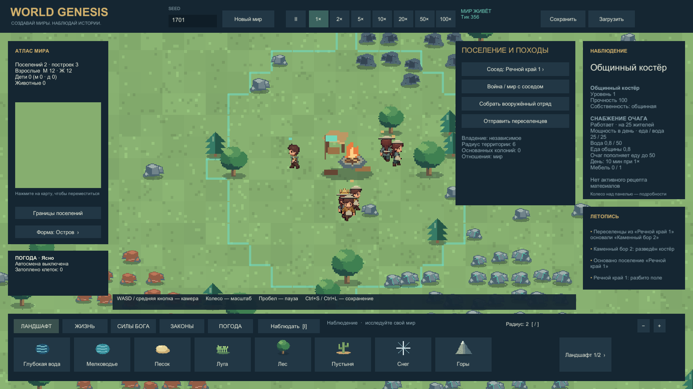
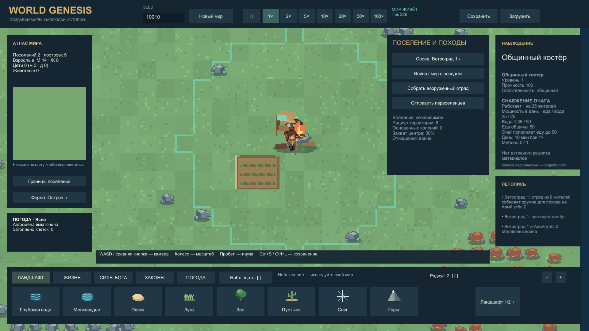
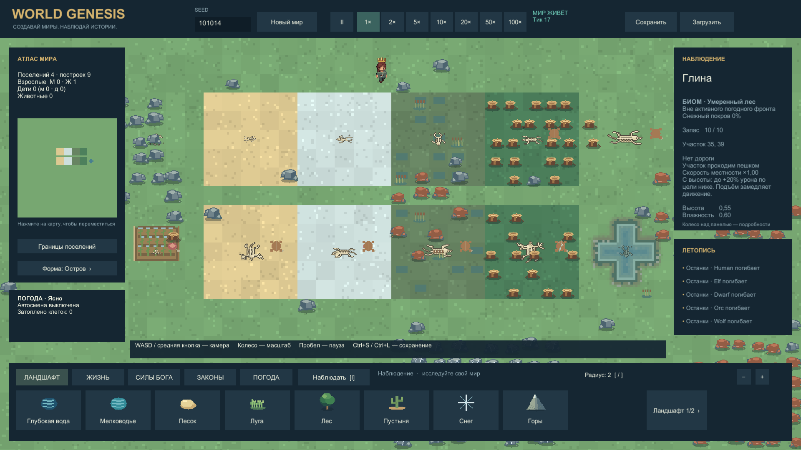
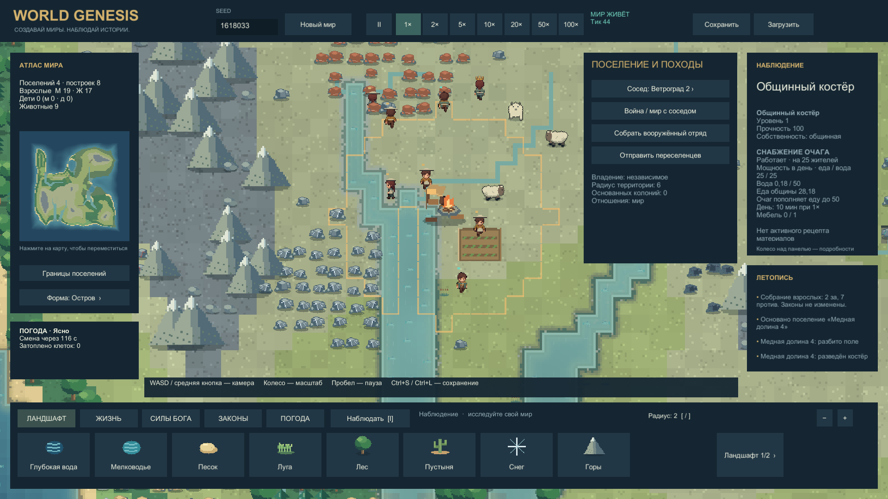

# World Genesis 0.10 — поселения, походы и останки

14.10.2026. Настоящие кадры финального Windows Player, Unity6000.0.45f1. Шесть PNG1920×1080, два ролика1280×720/10fps без звука. Изображения не дорисованы. Технический просмотр выполнен; художественное принятие пользователем ожидается. [Отчёт и ограничения](EXPANSION_REPORT.md).

## 1. Шесть переселенцев в пути

Подготовленный сухопутный мир: 24 взрослых, настоящий запас досок/провизии, выключены рождение, погода, старение и пополнение фауны. Дальше работает обычный Step: взрослые получают груз и идут к выбранному месту. Видны четыре доски и два носильщика с едой/водой. Камера и выбор клетки заданы автоматическим захватом.

[▶ Движение отряда — 8 секунд](../../Evidence/Captures/20261014-081318-settlers-walking-final.mp4). Просмотрены кадры20/60: меняются положение и фазы шагов, груз движется с людьми.

## 2. Новый город

Продолжение того же подготовленного мира после обычного прибытия. Костёр построен из доставленных досок, шесть существующих жителей стали населением нового поселения. Бесплатные жители и готовая ферма не созданы.

## 3. Удержание вражеского центра

Подготовленный мир с14людьми и8орками. Исследования выданы сценарием, в кузнице лежат шесть настоящих копий. Защитники заранее размещены вдали от центра и остаются живы. Захват выполняется через обычное движение и 20-секундный таймер; этот кадр не демонстрирует бой с защищённой крепостью.

## 4. Новый суверен

Продолжение того же сценария: сменились цвет территории и суверен в инспекторе. Остались22жителя, прежние здания и местные запасы. Нельзя трактовать сцену как доказательство естественной военной экономики или автономного объявления войны.

## 5. Кости на разных поверхностях

Существа разных видов были расставлены, здоровье обнулено сценарием, после чего обычный RemoveDead создал останки и положенную добычу. Кости видны на земле, снегу, траве и культурах. Мешки сдвинуты визуально, координаты товаров в симуляции прежние.

[▶ Исчезновение останков — 12 секунд](../../Evidence/Captures/20261014-081409-remains-fade-final.mp4). Сохранение подготовлено после140с жизни останков; ролик показывает последний участок обычного таймера. На кадрах0/119 кости исчезают, добыча остаётся. Полный срок на суше150с, в воде30с симуляции.

## 6. Обычный новый мир

Обычная генерация seed1618033 без расстановки содержимого: четыре поселения, восемь построек, 36 взрослых и девять животных в момент кадра. Автоматизированы только время захвата и камера. Это короткий запуск; выживание поколений и поздняя экономика этим кадром не доказаны.

У каждого кадра рядом сохранены `.png.json` состояния и `-run.json` исходников/команды; у роликов — `.mp4.json` и `.mp4.build.json`. Исторический r2 содержит найденное перекрытие костей и неудачное наведение камеры на отряд; они сохранены как история проверки и не заменяют финальные свидетельства.
