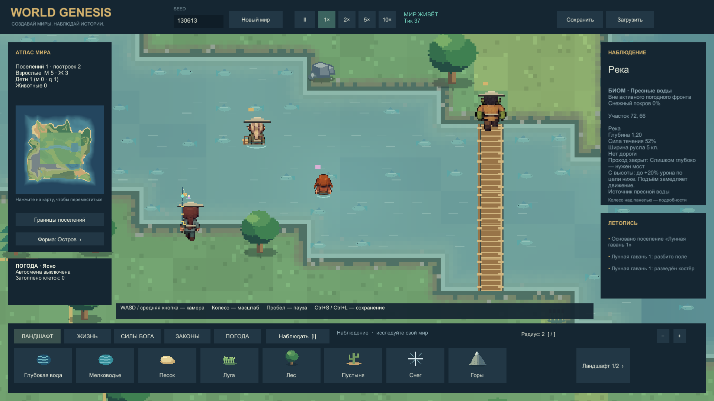
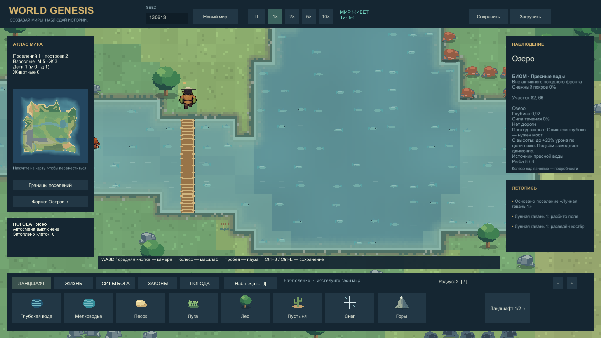
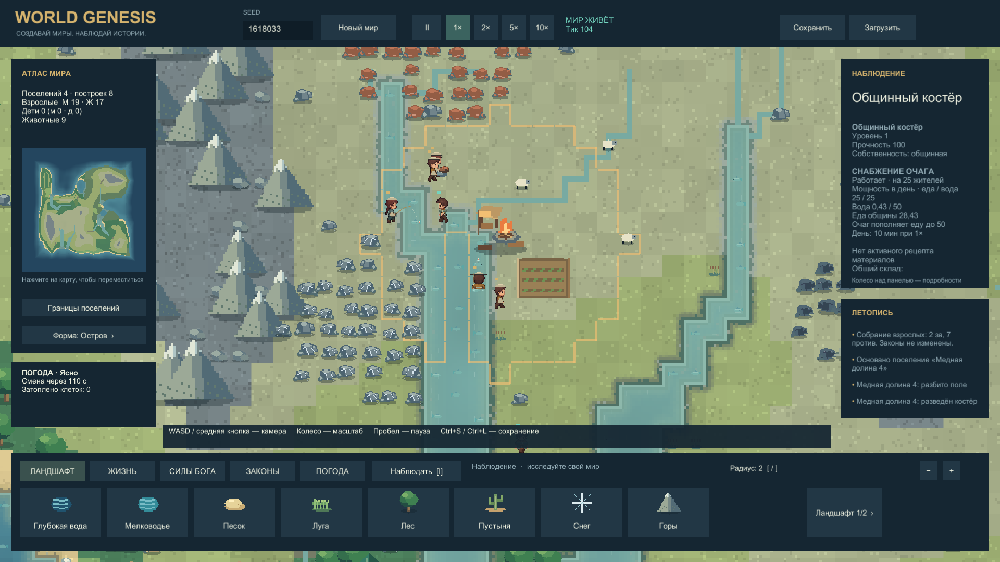

# Рыбалка, реки и берег · галерея 0.6.1

13.10.2026. Настоящие кадры Windows Player, Unity6000.0.45f1. [Что реализовано и проверено](FISHING_RIVERS_REPORT.md) · [Снасти, виды рыбы и рецепты](../Design/FISHING.md).

## Пять удочек и берег

Рукояти, обвязка, катушки и украшения соответствуют грейду. Удочка отображается во время настоящей задачи ловли; леска заканчивается в водной клетке. На берегу видны влажная почва, галька и светлое мелководье.

## Брод и мост

Эльф и ребёнок идут через мелководье: ноги под водой, тело и корзина опущены, вокруг пояса рябь. Орк на мосту остаётся полностью видимым. Глубокая и быстрая вода не стала проходимой из-за визуального изменения.

## Озёрный берег

Озеро получает спокойную рябь, река — направленные полосы течения. Видимые значки рыб представляют общий запас клетки, а не отдельные особи десяти видов.

## Движение

[Открыть нативный клип: течение, удочки и выход из воды](../../Evidence/Captures/20261013-150516-river-current-and-wading-final.mp4) · [Постер](../../Evidence/Captures/20261013-150516-river-current-and-wading-final.mp4.png).

6секунд, 60 захваченных кадров, 1280×720, без аудио. Камера автоматическая; сглаживающей генерации кадров нет, MP4 кодируется из кадров Unity. Просмотрены кадры0/30/59; художественное принятие пользователем отдельно.

Эти три речных ракурса и клип сняты на подготовленной карте seed130613: задано русло, запасы, мост, снасти1–5 и маршруты. Первый заброс продлён до20с для обзора после загрузки. Дальше работают обычные таймеры и движение симуляции. Это не обещание такого стартового оснащения в новой игре. [Рецепт сцены](../../Tools/FishingShowcase/README.md).

## Обычный старт

Стандартный мир seed1618033, камера у поселения; без увеличения населения, правки берега и выдачи улучшенных снастей. В двух отдельных естественных600-секундных прогонах жители сами ловили и доставляли рыбу. Полное развитие снастей1→5 за эти прогоны ещё не произошло.
