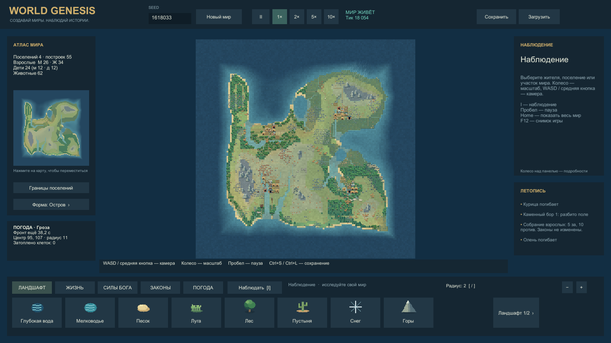
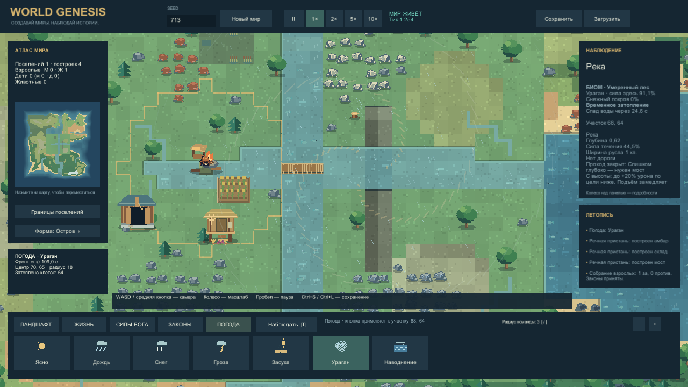

# Галерея World Genesis 0.5

Семь разных кадров из финального **Unity Windows Player 0.5.0**. Снимки не ретушировались. Это технически просмотренная альфа; художественное принятие пользователем отдельно. Дата:12.10.2026. У каждого PNG рядом `.json` и `-run.json` с состоянием и хешами; у poster урагана — JSON/receipt его MP4.

## Общий вид мира

Seed1618033, четыре поселения, 84 жителя и 62 животных в момент кадра. Мир развивался 1800 секунд симуляции без выдачи материалов/технологий; исходное заселение и камера автоматизированы. Гроза на северо-востоке возникла автоматически.

## Поселение у гор и реки

Тот же естественный мир: поля, дома, жители и добываемые ресурсные группы. Камера автоматически наведена на поселение; скорость1×.

## Снег

Подготовленная сцена seed713: снег вызван штатной командой, у1009 клеток температура установлена0.18 для проверки покрытия. Строения и мост из транспортного showcase; технологии и материалы выданы заранее.

## Засуха и распространяющийся пожар

В подготовленном мире засуха работает реальными тиками: иссушение и возгорание не нарисованы поверх кадра. Языки пламени показывают actual Tile.Fire. Видна запись возврата45% материалов; это единичный случай из диапазона10–50%.

## Паводок и мост — интерфейс1280×720

Наводнение вызвано штатной командой в подготовленной долине. Вода меняет глубину, проходимость и срок отступления. Прямоугольный контур отражает выровненный тестовый участок; это не естественная статистика паводков.

## Движущийся ураган

Кадр нативной последовательности подготовленного мира. Рукава ветра следуют сохранённому центру, затопление и урон считает симуляция. Вихрь пока тонкий и требует визуальной доработки.

## Амбар четвёртого уровня

Подготовленный складской сценарий: четыре уровня, занято450 из10000, зерно/ягоды/сено. Постройка и улучшения выполнены штатными операциями после явно выданных ресурсов и исследований. Рядом склад материалов и законченный мост.

## Движение и проверка

[Ураган, около6секунд](../../Evidence/Captures/20261012-170743-climate-hurricane-final.mp4) · [Пожар, около6секунд](../../Evidence/Captures/20261012-171427-climate-fire-final.mp4). Кадры захвачены Player с частотой около10Гц и собраны в MP4; такой захват не измеряет FPS. Камера и выбор вкладки автоматизированы.

[Отчёт реализации](TRANSPORT_REPORT.md) · [Независимое визуальное ревью](CLIMATE_NATIVE_REVIEW.md) · [Скачать игру](https://github.com/MixonUP/world-genesis/releases/tag/v0.5.0-alpha).
