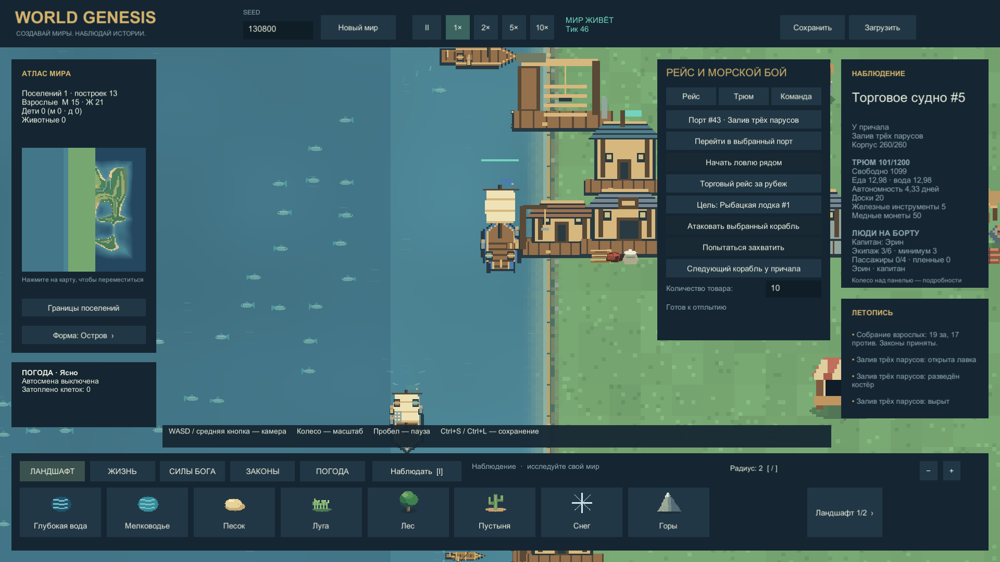
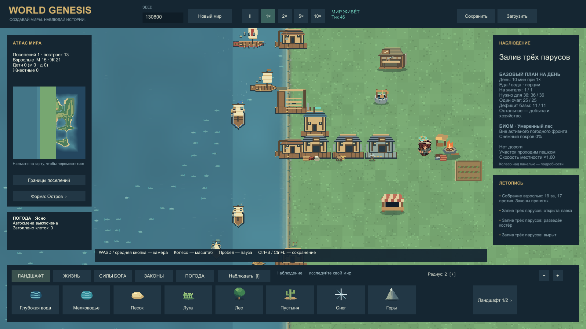
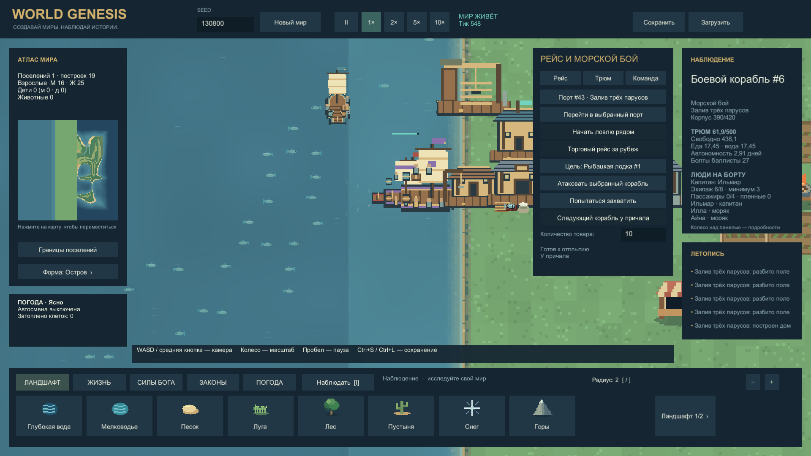
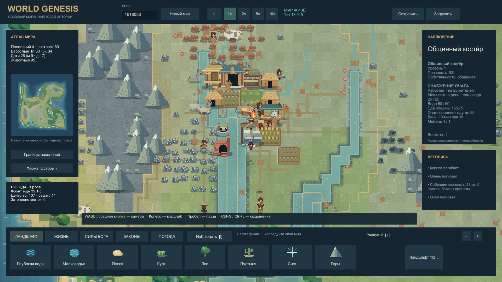
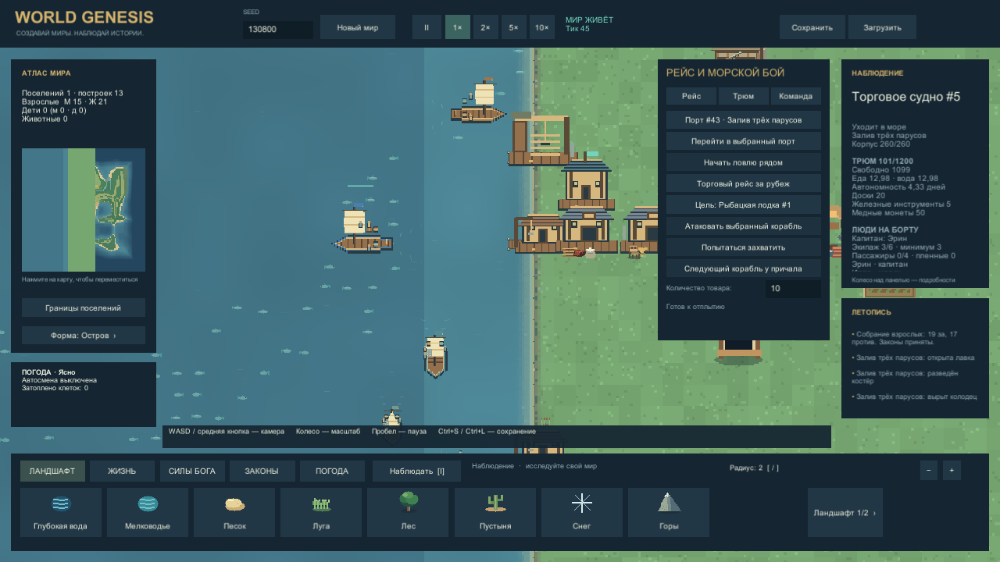

# Море и рынок 0.8 — кадры из Unity

14.10.2026. Windows Player из snapshot `maritime-v080-r2`, 1920×1080, скорость симуляции 1×. Это реальные игровые кадры, не концепты. Камера и выбор объекта заданы служебной командой. [Отчёт](MARITIME_REPORT.md) · [механика моря](../Design/MARITIME.md) · [обычная экономика](MARKET_PROGRESS_REPORT.md).

## Порт и торговое судно

Судно №5 находится у сохранённого причала. На борту три настоящих жителя, еда, вода, доски, пять инструментов и монеты. Настил ведёт к водной клетке, корпус виден рядом с портом. Погрузка выполнена через общую сеть складов.

## Флот и три уровня склада

Подготовлены шесть собственных типов судов. Три портовые секции уровней 1/2/3 дают 5000+10000+20000 = 35000 мест. Общий кадр показывает квартал и часть флота; нижняя панель перекрывает отдельные суда. Это не сравнительная таблица всех девяти корпусов.

## Странствующий торговец

Великий странник №7 пришёл через морскую границу. Вместимость 20000, фактическая загрузка около 6233: доски, железная руда, медь, зерно, монеты, редкая жемчужина и провизия. Вместимость не означает автоматически полный трюм.

## Морской бой

Бой расходует баллистные болты, повреждения отражены в состоянии корпуса. На борту шесть участников и капитан. Начальная боевая позиция подготовлена сценарием; снимок не доказывает самостоятельного решения о войне или завершённого захвата. Крупные корпуса могут визуально перекрываться на близких позициях — требуется развести стоянки/боевой строй.

## Обычное поселение

Seed1618033 после 1800 секунд симуляции и нескольких секунд запуска Player. Этот мир развивался без выданных исследований, товаров и флота. В нём изготовлены четыре одежды, но ещё нет рабочего железного инструмента, денежного оборота или порта. [Второй seed и точные ограничения](MARKET_PROGRESS_REPORT.md).

## Движение

80 настоящих кадров с выборкой 10 Гц, 1280×720, около 8 секунд, без аудио. Проверены начало, середина и конец: корабль идёт на запад, поворачивает корпус, появляется след, запас провизии снижается. Камера неподвижна; к концу судно уходит за левую панель. Видеозахват влияет на быстродействие и не заменяет отдельный FPS-профиль.

## Условия и визуальные границы

Первые четыре сцены и клип подготовлены `Tools/MaritimeShowcase`: выровненный берег, открытые технологии, конечный строительный бюджет, стартовые запасы, корпуса, экипажи и позиции выданы явно. Портовые здания/улучшения оплачены обычными командами. Движение, погрузка, провизия, торговля и атака используют игровую Simulation. Реальное строительство корпуса и подход моряков отдельно проверены тестами. Это не естественная прогрессия.

Миграция проверена отдельным запуском [неизменённого сохранения 0.7](../../Evidence/Captures/20261014-002531-maritime-legacy07-final-r2.png). Первые два отказа загрузки были вызваны двойной упаковкой в скрипте подготовки кадра; исправлен именно скрипт, игровой код не менялся. Исходные файлы и исправленные копии имеют одинаковые SHA.

Детализация палуб и парусов пока простая, толпа у костра плотная, некоторые корпуса перекрываются. Интегратор и независимый рецензент просмотрели изображения; художественное принятие пользователем остаётся открытым. [Независимое ревью](MARITIME_INDEPENDENT_REVIEW.md). В `Evidence/Captures` рядом с кадрами лежат JSON с исходным сохранением, SHA сборки и состоянием корабля.
