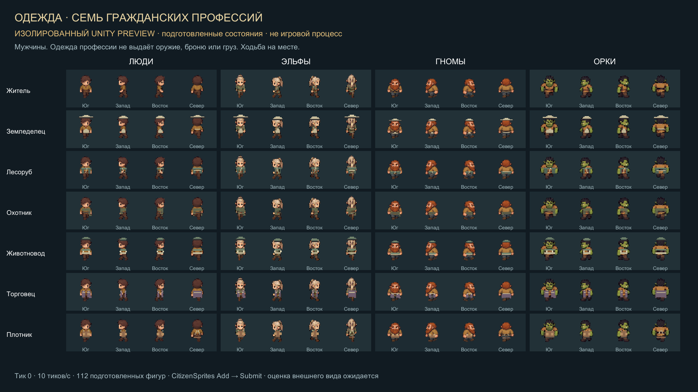
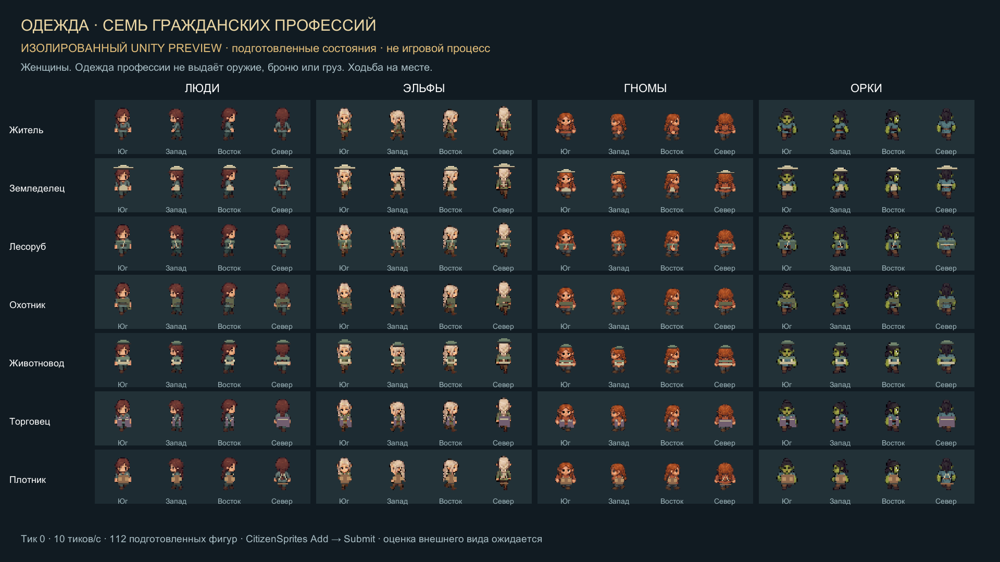
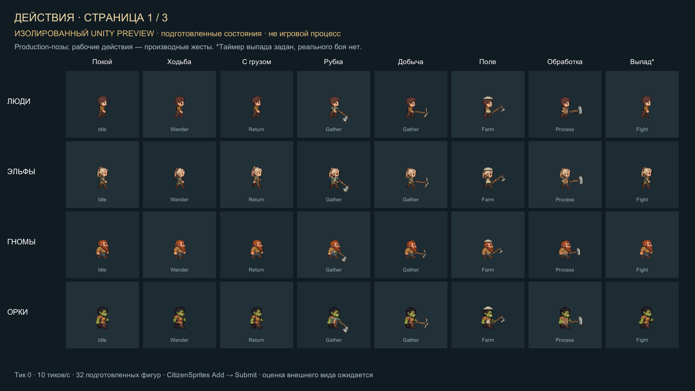
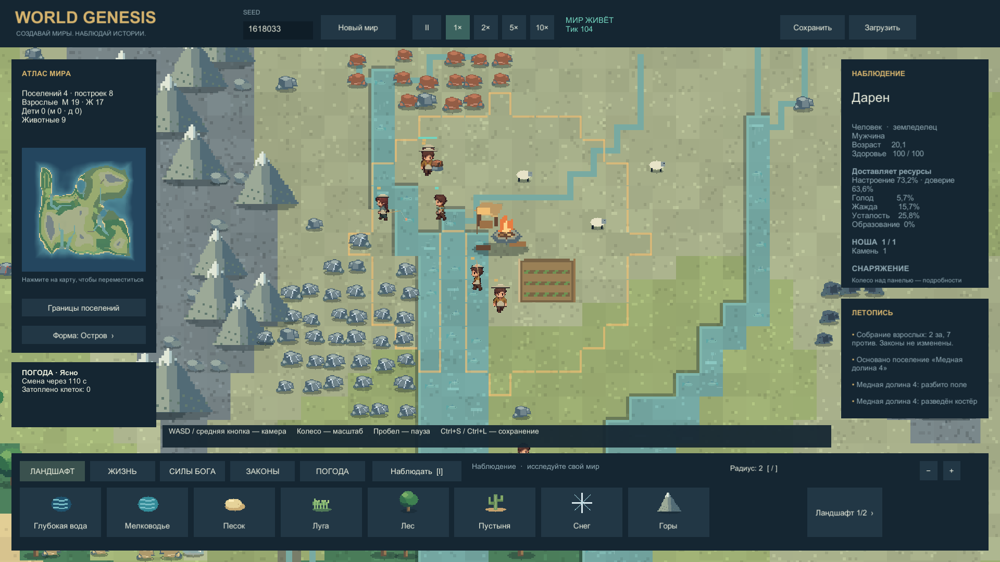

# Собственные жители — нативная галерея

Обновлено 12.10.2026, 21:08 +03:00. Собственные люди, эльфы, гномы и орки: мужчины, женщины, мальчики и девочки. Изображения ниже — захваты Unity Player, а исходные тела подготовлены с `image_gen`. [Происхождение](../../SourceAssets/OriginalCitizens/PROVENANCE.md), [покрытие и проверки](ORIGINAL_CITIZENS_REPORT.md).

**Листы семей, одежды и действий показывают подготовленные состояния через production-рендерер: это изолированный preview.** Отдельный раздел внизу содержит обычный игровой процесс. Одежда и действия сняты из r4 после исправления шапок; контакт с головой проверен интегратором. Независимый просмотр выборки завершён; P1/P2 в финальной выборке не обнаружены, художественное принятие пользователем ожидается.

## Четыре народа и четыре семейных профиля

[Открыть PNG 1920×1080](../../Evidence/Captures/20261012-205029-064-citizen-gallery-families-male-p0.mp4.png) · [Короткий клип ходьбы](../../Evidence/Captures/20261012-205029-064-citizen-gallery-families-male-p0.mp4) · [Квитанция захвата и хеши](../../Evidence/Captures/20261012-205029-064-citizen-gallery-families-male-p0.mp4.build.json)

64 фигуры: 16 профилей в четырёх направлениях. Ходьба на месте, 60 нативных образцов примерно за 6 секунд; MP4 сохраняет интервалы записи. Этот кадр снят из r2 и сохранён как показ неизменённых базовых тел без профессиональных шапок. Одежда r4 показана отдельно ниже.

## Семь гражданских профессий

[PNG: мужчины](../../Evidence/Captures/20261012-210142-098-citizen-gallery-wardrobe-male-p0.mp4.png) · [Клип движения](../../Evidence/Captures/20261012-210142-098-citizen-gallery-wardrobe-male-p0.mp4) · [Квитанция](../../Evidence/Captures/20261012-210142-098-citizen-gallery-wardrobe-male-p0.mp4.build.json)

[PNG: женщины](../../Evidence/Captures/20261012-210215-781-citizen-gallery-wardrobe-female-p0.mp4.png) · [Клип движения](../../Evidence/Captures/20261012-210215-781-citizen-gallery-wardrobe-female-p0.mp4) · [Квитанция](../../Evidence/Captures/20261012-210215-781-citizen-gallery-wardrobe-female-p0.mp4.build.json)

На каждом листе 112 фигур: 7 профессий × 4 расы × 4 направления. Одежда не выдаёт оружие, броню или груз. По 60 нативных образцов, 1920×1080, около 6 секунд, тики 0→60.

## Действия

| Набор | PNG | Клип | Квитанция |
|---|---|---|---|
| Мужчины: покой, ходьба, груз, рубка, добыча, поле, обработка, заданный выпад | [Открыть](../../Evidence/Captures/20261012-210242-360-citizen-gallery-actions-male-p0.mp4.png) | [MP4](../../Evidence/Captures/20261012-210242-360-citizen-gallery-actions-male-p0.mp4) | [JSON](../../Evidence/Captures/20261012-210242-360-citizen-gallery-actions-male-p0.mp4.build.json) |
| Женщины: те же восемь состояний | [Открыть](../../Evidence/Captures/20261012-210322-819-citizen-gallery-actions-female-p0.mp4.png) | [MP4](../../Evidence/Captures/20261012-210322-819-citizen-gallery-actions-female-p0.mp4) | [JSON](../../Evidence/Captures/20261012-210322-819-citizen-gallery-actions-female-p0.mp4.build.json) |
| Страница 2: бегство, еда, отдых, общение, детские игра/учёба, питьё, рыбалка | [Открыть](../../Evidence/Captures/20261012-210358-624-citizen-gallery-actions-male-p1.mp4.png) | [MP4](../../Evidence/Captures/20261012-210358-624-citizen-gallery-actions-male-p1.mp4) | [JSON](../../Evidence/Captures/20261012-210358-624-citizen-gallery-actions-male-p1.mp4.build.json) |
| Страница 3: стадо, пивоварение, ремесло, стройка, переноска, караван, путь охотника, обход | [Открыть](../../Evidence/Captures/20261012-210410-582-citizen-gallery-actions-male-p2.mp4.png) | [MP4](../../Evidence/Captures/20261012-210410-582-citizen-gallery-actions-male-p2.mp4) | [JSON](../../Evidence/Captures/20261012-210410-582-citizen-gallery-actions-male-p2.mp4.build.json) |

На каждой странице 32 фигуры, 60 нативных образцов 1920×1080, около 6 секунд, тики 0→60. Груз, ресурсный узел, таймер выпада и проект стройки — подготовленные условия. Жители не проходят AI; инструменты и жесты отображаются production-кодом. Кадры не доказывают реальную добычу, бой, доставку или естественную прогрессию.

SHA256 всех шести новых MP4 и PNG сверены с квитанциями; ошибок Runtime в них не зарегистрировано. [304 файла финального r4 совпали со snapshot](../../Evidence/Development/original-citizens-final-build.json).

## Обычный игровой процесс

[Городской PNG 1920×1080](../../Evidence/Captures/20261012-210551-original-citizens-town-final.png) · [Игровой MP4](../../Evidence/Captures/20261012-210603-original-citizens-gameplay-final.mp4) · [Постер клипа](../../Evidence/Captures/20261012-210603-original-citizens-gameplay-final.mp4.png) · [Квитанция игрового кадра](../../Evidence/Captures/20261012-210551-original-citizens-town-final.png.json) · [Квитанция клипа](../../Evidence/Captures/20261012-210603-original-citizens-gameplay-final.mp4.build.json)

Это настоящая симуляция, без gallery fixtures. Камера и выбор жителя подготовлены автоматически. Seed 1618033, карта 128×128, скорость 1×; в городском кадре тик 105, 45 существ, выбранный взрослый возвращается с `RawStone=1`. Клип содержит 60 нативных кадров.

Отдельный [профиль 1000 существ](../../Evidence/Captures/20261012-210445-original-citizens-1000-final-profile.json): 29.994 с, 4020 кадров, 1000→1000, 134.03 FPS в среднем, p99 20.83 мс, максимум 27.79 мс, Gen0=52. Ryzen 9 7950X / RTX 4090, 1280×720, карта 128×128, скорость 1×. Это короткая диагностическая нагрузка; сравнение скорости с прежним погодным сценарием не проводится. Публикация в GitHub этой страницей не заявляется.

Рабочие действия используют производные жесты тела и контекстные предметы. Они не считаются отдельными нарисованными циклами. Точное равенство количеству анимаций WorldBox не установлено — [проверенные источники и неизвестные параметры](../Research/WORLDBOX_ANIMATION_COVERAGE.md).

## Публикация · 2026-10-12 21:15 +03:00

Исходники, PNG/MP4 и документация опубликованы в commit 5cbe95d8f4caddb76e23b7db69e0e5e1ea16f1c9, ветка codex/world-genesis. Удалённый SHA и открытая галерея проверены, четыре встроенных изображения загрузились в полном размере. [Подтверждение](../../Evidence/Development/published-original-citizens.json). Независимое [визуальное ревью](ORIGINAL_CITIZENS_VISUAL_REVIEW.md) завершено: исправление шапок подтверждено, P1/P2 в выборке не обнаружены; P3 и границы просмотра сохранены. Локальный архив Builds/WorldGenesis-v0.6.0-alpha-win64.zip проверен по каждому файлу. Бинарник 0.6 в GitHub Releases не загружался.
