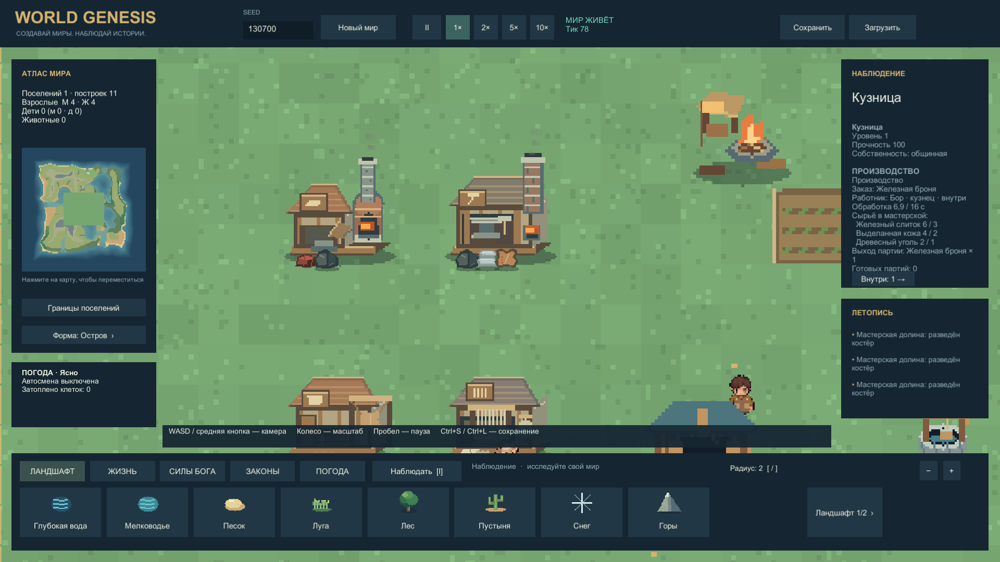
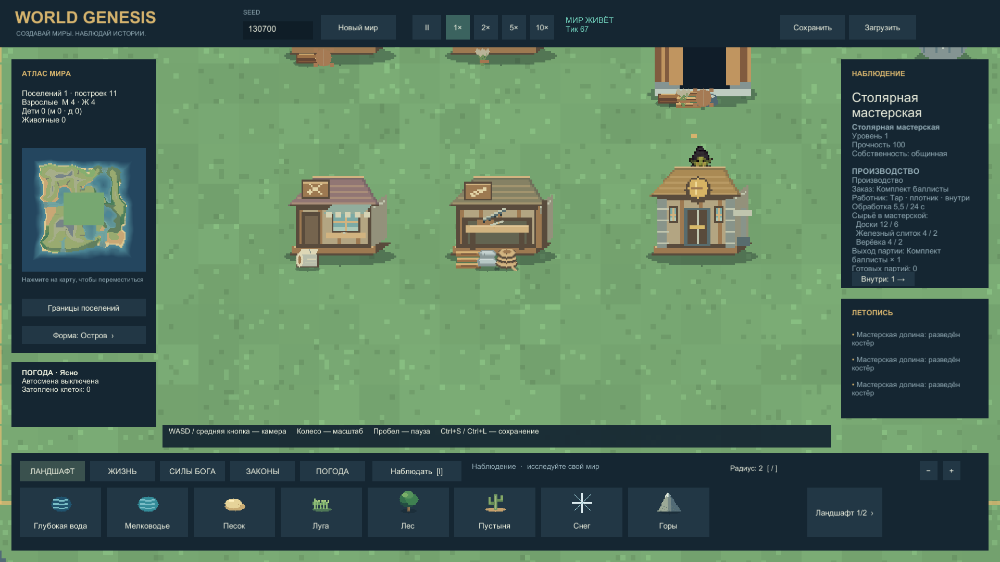
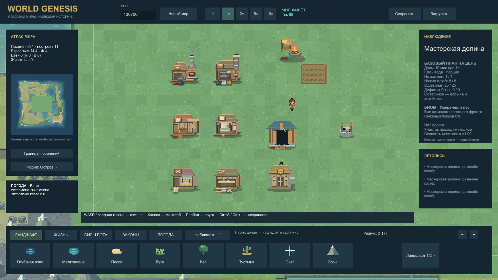
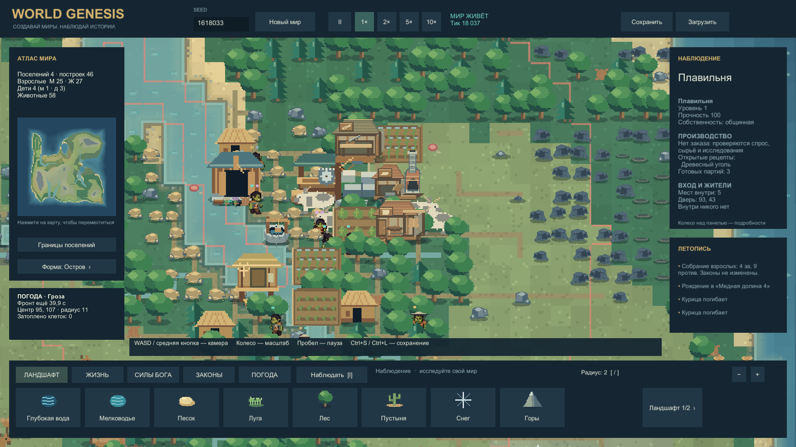

# Производство и здания · галерея 0.7

Все изображения сняты в настоящем Windows Player Unity6000.0.45f1, 13.10.2026. Это не концепты и не AI-дорисовка. [Отчёт и проверки](PRODUCTION_REPORT.md) · [оценка независимого аналитика](GAME_ANALYST_REVIEW_0_7.md).

## Кузнец работает внутри

Бор находится внутри кузницы и изготавливает железную броню. Внешнего спрайта и груза поверх крыши нет; карточка сообщает место, занятие и потребности. Кнопки «Внутри:1» и «К зданию» позволяют наблюдать скрытых жителей. [Квитанция Player](../../Evidence/Captures/20261013-223534-buildings-resident-r7.png.json): SelectedUnit27, InsideBuilding14, TaskProduce.

## Материалы и работа кузницы

Запасы железа, кожи и угля находятся в здании. HUD показывает реального работника внутри и прогресс6,9/16с; огонь печи связан с активной работой.

## Осадные комплекты делает плотник

Плотник внутри обрабатывает доски, железо и верёвку после исследования. Это изготовление комплекта баллисты, а не уже работающая осада. Справа виден житель за монетным двором: крыша закрывает нижнюю часть его силуэта.

## Семь мастерских

Плавильня, кузница, кожевня, ткацкая и швейная мастерские, столярная мастерская и монетный двор. Склад и колодец обслуживают квартал.

**Подготовка этих четырёх сцен раскрыта:** Tools/ProductionShowcase расчистил участок, выдал технологии, строительный бюджет, сырьё и промежуточные товары. Здания оплачены через API, подход/вход/работа/перенос выполняются обычной симуляцией. Это проверка связанного поведения и отображения, не доказательство естественного открытия всех технологий. [Исходный мир и проверка продолжения](../../Evidence/Simulation/buildings-showcase-r5.json).

## Обычное поселение после30минут симуляции

Seed1618033,1800simsec до загрузки в Player; без выдачи технологий и материалов после обычного старта. Плавильня завершила три партии угля, сейчас внутри никого нет. Видны дома, склады, поля, лес и берег. Всего в этом мире14производственных партий; поздние металлы и снаряжение ещё не появились. [Естественный прогон](../../Evidence/Simulation/production-interior-natural-final-r2.json).

## Вход и работа в движении

[▶ Восьмисекундный ролик: обход стены → дверь → работа внутри](../../Evidence/Captures/20261013-223558-buildings-entrance-r7.mp4)

Подготовленный вариант мира ставит кузнеца севернее мастерской. Дальше он сам идёт по обычному маршруту; в начале HUD сообщает «снаружи», после входа — «внутри» и растущий прогресс. Просмотрены исходные кадры0,10,20,30,60,79; это выборочная техническая проверка, не полная художественная приёмка.80нативных кадров1280×720 сняты примерно10раз/с и закодированы в30FPS; запись влияет на нагрузку, аудио в клипе нет. [Времена и тики](../../Evidence/Captures/20261013-223558-buildings-entrance-r7.mp4.json).

Основные кадры зданий сняты сборкойr6, карточка жителя и ролик —r7. Единственная разницаr6→r7 — исправление служебного выбора жителя при автоснимке и поле квитанции; Simulation, арт и глубина не менялись. [Сравнение353файлов](../../Evidence/Development/buildings-final-source-match.json). Комнаты, снятие крыши и многоэтажность ещё не реализованы; художественное принятие пользователем не заявлено.
