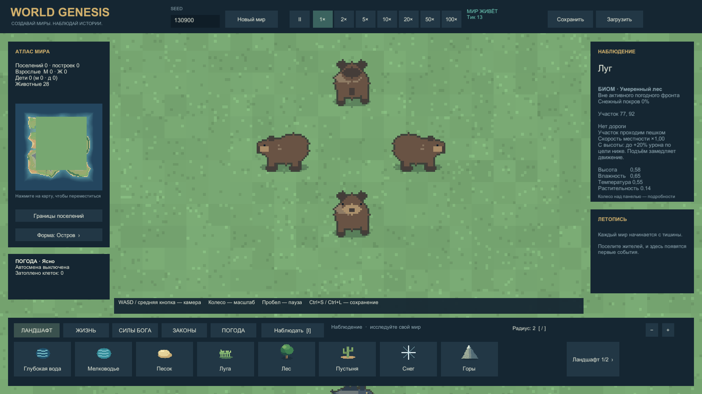
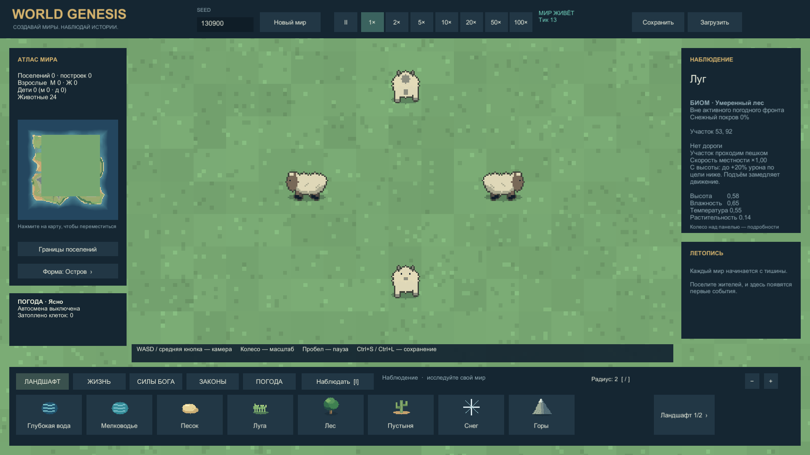
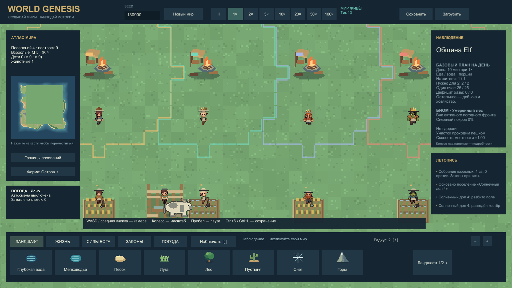
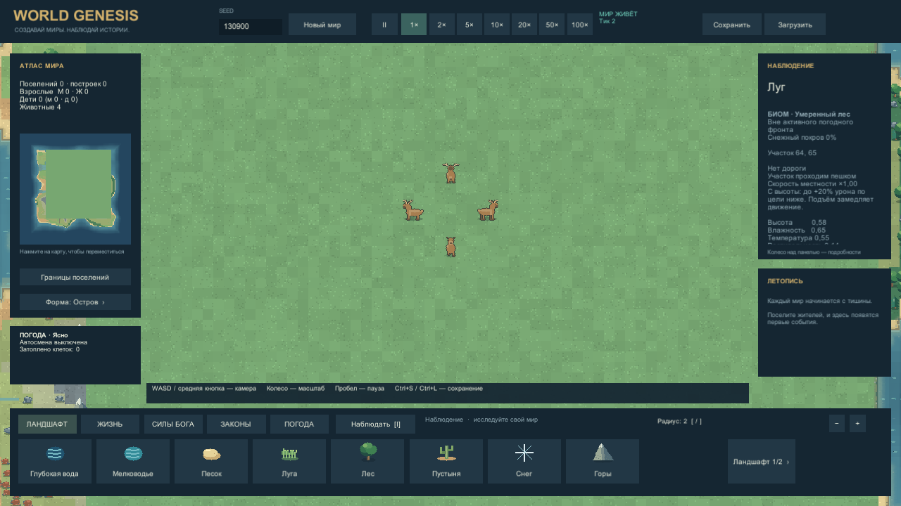
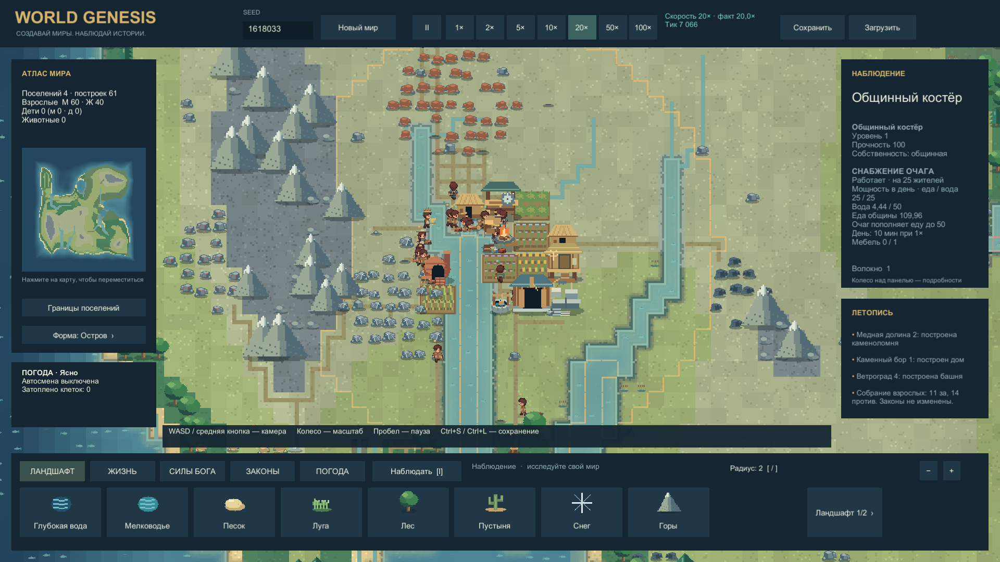
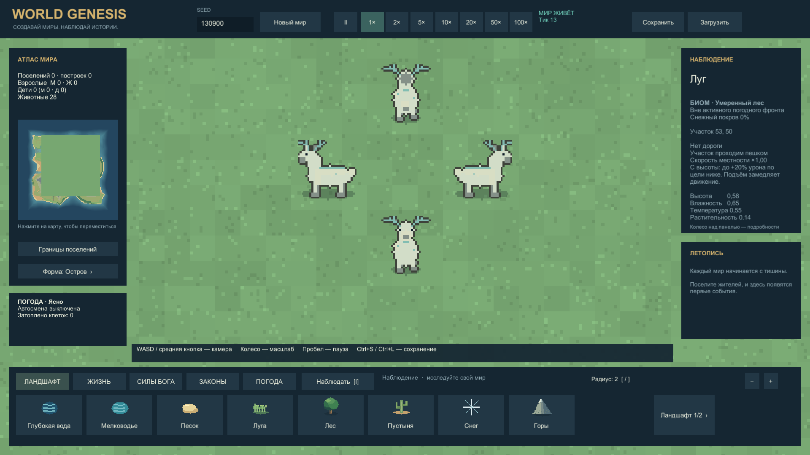
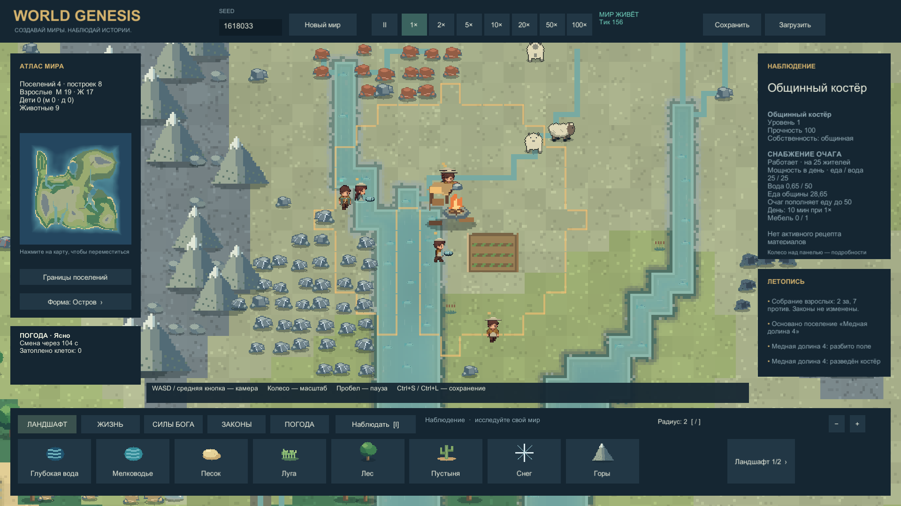

# World Genesis0.9 — кадры из Windows Player

14.10.2026. Основные кадры и клип — snapshot `speed-fauna-music-v090-r2`; лунные олени после исправления остановки и обычный запуск внизу — финальный r3. Это настоящие снимки Unity, не концепты. [Отчёт и скорость](SPEED_FAUNA_REPORT.md), [сценарии и помощь](../../Tools/FaunaShowcase/README.md).

Животные специально расставлены для сравнения сторон. Поселения, культуры и правители в сцене полей подготовлены; они не доказывают естественное развитие. Масштаб приближен для чтения деталей. Корона/поля дополнительно проверены настоящим RenderTexture, а движение — отдельным клипом. Художественное принятие пользователем остаётся открытым: крупные бока животных пока выглядят плоско, детализацию можно развивать дальше.

## Четыре стороны

| Волки | Медведи |
|---|---|
|  |  |

## Поля и правители

Работники стоят поверх поля и пастбища. Закрытые дома сохраняют другое правило глубины.

Четыре действующих правителя: люди, эльфы, гномы, орки. Корона привязана к верхним пикселям текущего головного убора/волос, учитывает пол и расу.

## Движение

[▶ Семь секунд ходьбы в четырёх направлениях](../../Evidence/Captures/20261014-014142-fauna-walking-final.mp4).70нативных кадров с реальными временными метками, без offline-симуляции и без подложенного саундтрека. Просмотрены начало, середина и финал; направления и положения меняются, южная самка оленя без рогов. Кадр не является доказательством музыки.

## Скорость в интерфейсе

Это отдельная нагрузочная сцена100жителей с помощью здоровью. Все семь кнопок доступны. Фактическое20,00× здесь подтверждено данными;100× на1000жителях не достигнуто, подробности в отчёте.

Дополнительные обзоры: [домашние виды](../../Evidence/Captures/20261014-014122-fauna-domestic-overview.png), [лесные виды](../../Evidence/Captures/20261014-014116-fauna-woodland-overview.png). Обзор лесных видов частично закрывает нижнюю группу панелью. Первый слишком тесный кадр медведей сохранён в evidence, в галерее используется повтор с полным силуэтом.

## Исправленная остановка и обычный запуск r3

Первый отдельный кадр лунных оленей выявил сброс направления вправо в конце маршрута. Он сохранён как история ошибки. После исправления малого вектора пути четыре стороны сохраняются и после полной остановки, на тике13:

Дополнительно проверены [сам последний маленький шаг](../../Evidence/Captures/20261014-015607-fauna-spirit-stag-arrival-fixed.png) и [длинные расходящиеся маршруты](../../Evidence/Captures/20261014-015613-fauna-spirit-stag-directions-final.png). Регрессия вошла в повторные65/65PlayMode.

Обычный старт финальной сборки: стандартный seed1618033, без выдачи ресурсов/исследований или усиления здоровья. Камера автоматически приближена к поселению. Музыка в этом запуске подтверждена данными Player, изображение само по себе звук не доказывает.

