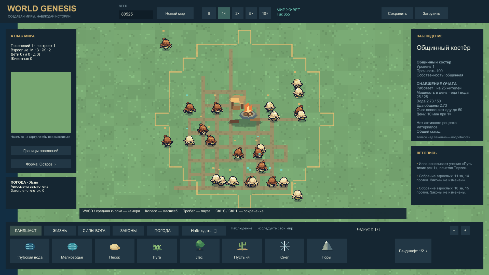
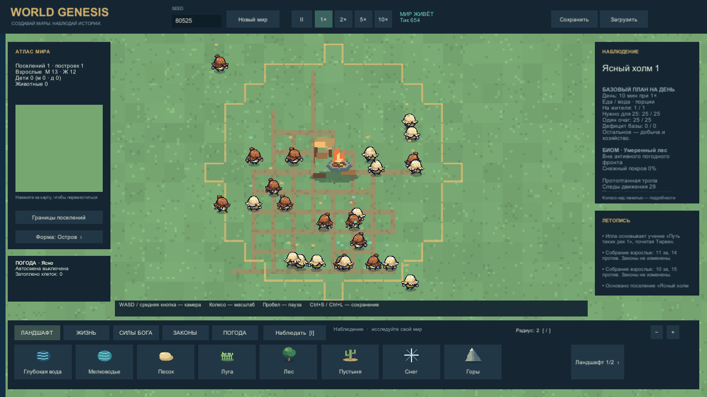

# Костёр и суточное потребление · 0.5.1

Решение пользователя: общинный костёр пассивно обеспечивает базовой едой и водой 25 жителей. Реализация использует общий норматив хозяйственных суток из проекта экономики, теперь закреплённый в коде.

## Правила

- Хозяйственные сутки: 600 секунд симуляции (6000 тиков). При 1× это10минут, при2× —5минут, при5× —2минуты, при10× —1минута. Пауза останавливает производство и потребности. Это экономический масштаб; ускоренные возраст и исследовательский цикл остаются отдельными.
- Базовая норма каждого цивилизованного жителя, включая детей:1 порция еды и1 единица воды в сутки. Дикие животные сохраняют собственный прежний голод.
- Голод и жажда растут непрерывно на0.4/600 в секунду. Еда или питьё1ед снимает0.4 потребности. Жители физически приходят к запасу; списание происходит после окончания действия, не у всех в полночь. Норма — долгосрочная потребность: в отдельных сутках число приёмов зависит от начального состояния, пути и задержек. Частичная переносимая вода снимает потребность пропорционально.
- Один живой Hall с минимальнымID на поселение — общинный костёр/его улучшенный центр. Он производит25еды и25воды за сутки без работника и сырья, постепенно по тикам. Уровень и дубликаты не умножают выпуск. Сгоревший, затопленный до непроходимости или разрушенный костёр не производит; горение определяется опасным огнём на тайле, обычная картинка очага не считается пожаром.
- Еда поступает в общий запас порций поселения, пока он меньше50. Добытая сверх50еда не пропадает и не обрезается: при большем запасе останавливается только базовая выработка. Это не вместимость амбара и не бесплатные зерно/мясо/ингредиенты.
- Питьевая вода хранится у самого костра, предел50. Житель должен дойти и закончить питьё. Колодцы и пресные воды продолжают работать. Пивоварение по-прежнему получает воду через существующую доставку от колодца; пассивный запас не стал дистанционным сырьём для варки.
- 25 жителей: базовый баланс25−25=0 для каждого ресурса.30жителей: нехватка5еды и5воды/сутки до учёта иных источников.50жителей: нехватка25/25. Рождения, плата за наём и производственные расходы считаются отдельно. Гарантия нормы не заменяет доступную дорогу к костру.
- При загрузке старого мира сохраняются запасы и потребности. SubsistenceVersion0→1 не выдаёт мгновенную еду/воду и не тратит RNG. Новый запас воды и продолжение производства сохраняются вместе с World.

## Проверяемый результат

Инспектор костра показывает мощность, реальные запасы и паузу производства. Инспектор поселения показывает базовые сутки/норму/потребность и нехватку относительно единственного работающего очага; прочая экономика не выдаётся за подсчитанный общий баланс.

Границы: нет нового полного календаря, возрастных коэффициентов питания, голода от тяжёлой работы или испарения запаса воды; это отдельные будущие решения. Новый расход заметно медленнее прежних0.005голода/с и0.003жажды/с. Старые natural-прогоны0.5 не доказывают баланс0.5.1.

## Проверка

Логика: 14/14 отдельных сценариев снабжения прошли в .NET. Они проверяют выработку, предел запаса, питьё, дубликаты, снос, изоляцию, бюджет 25/26, миграцию и одинаковое продолжение сохранения. [Результат](../../Evidence/Simulation/subsistence-probe-final.json), [описание сценариев и границ](../../Tools/SubsistenceProbe/README.md).

Обычное поведение 25 жителей проверено ещё в течение 3000 секунд симуляции — пяти хозяйственных суток после подготовки мира. Единственный источник — костёр; нет природной еды, полей, колодцев и выдач запасов. Все 25 остались живы с минимальным здоровьем 100; выполнены 125 приёмов еды и 100 приёмов воды, каждый у источника. Разница вызвана начальной фазой жажды: первое питьё произошло после первого суточного среза, затем по 25 порций за сутки. Все 30 000 состояний прошли Validate; запасы не уходили в минус. Погода, старение и рождения отключены, позиции и начальные потребности подготовлены; это проверка снабжения фиксированной общины, а не баланса естественного развития. [Полная квитанция](../../Evidence/Simulation/subsistence-sustain-final.json).

Первый полный Unity EditMode прогон: 214/215. Старый тест недоступного склада ожидал неизменного запаса без учёта новой пассивной выработки. Его начальный запас поднят выше мягкого предела, чтобы изолировать возможное дистанционное потребление. Следующий прогон — 215/215; аналогично уточнён сценарий единственного списания еды. Исторические ошибки сохранены в evidence. Игровую логику ради этих проверок не меняли.

Финальная проверка Unity: [215/215 EditMode](../../Evidence/20261012-180300-741-editmode/tests.xml), [20/20 PlayMode](../../Evidence/20261012-180934-523-playmode/tests.xml). После EditMode изменились только размещение текста HUD и проверка его видимости; Simulation и EditMode-тесты совпали по хешам. [Сравнение ревизий](../../Evidence/Development/subsistence-ui-only-revision.json).

Windows 0.5.1: [успешная сборка, 0 ошибок и 0 предупреждений](../../Evidence/Development/subsistence-build-final.json). Все 283 файла исходного snapshot `subsistence-release-v051-r3` совпали с рабочим проектом после сборки: [квитанция](../../Evidence/Development/subsistence-source-match.json). Два финальных запуска Player завершились без исключений; кадры просмотрены. Производительность на тысяче жителей повторно не измерялась; прежний профиль 0.5.0 не является измерением 0.5.1.

## Настоящие игровые кадры

Оба снимка сделаны из финального Windows Player при 1×. Подготовленный мир: seed 80525, 48×48, 25 взрослых и один костёр, без полей и колодцев. Начальные запасы убраны, природные источники, рождения, старение и погода отключены. Камера и выбор клетки автоматические. Подготовка нужна для изоляции снабжения; это не естественно выросшее поселение. [Исходная помощь и сохранение](../../Evidence/Simulation/subsistence-assisted-v051.json).

1920×1080: мощность 25/25, фактические запасы около 2,73, предел пополнения 50. Все строки снабжения помещаются в исходное окно.

1280×720: суточный план расположен в начале окна, видны 1/1 на жителя, потребность 25/25, выпуск 25/25 и дефицит 0/0 без прокрутки. Дальнейшие сведения прокручиваются. Шрифт при этом разрешении небольшой; увеличение масштаба UI остаётся отдельной задачей. Первый кадр до перестановки блока сохранён в evidence как история исправления. Пользовательское художественное принятие не заявлено.
