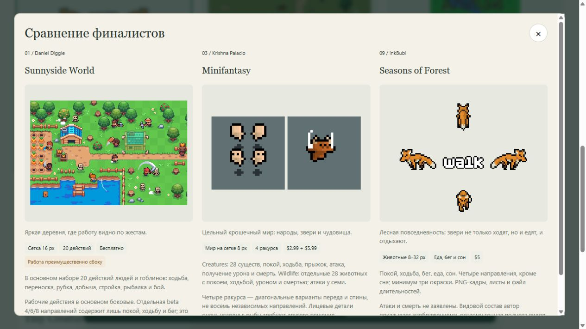

# Доска выбора существ

Проверено 2026-10-12 18:53 +03:00. Подборка подготовлена для решения пользователя, новый арт ещё не выбран и не импортирован. Исследователи жителей и фауны работали отдельно; интегратор собрал и просмотрел итоговую доску.

[Открыть интерактивную доску](../Art/creature-board/index.html) · [все карточки одним изображением](../../Evidence/Art/creature-board-full.png) · [животные](../../Evidence/Art/creature-board-fauna.png) · [машинный манифест](../Art/creature-board/manifest.json).

В текущем сеансе доска открыта по `http://127.0.0.1:8766/Docs/Art/creature-board/`. HTML можно открыть напрямую из локального клона. Для удалённых авторских превью нужен интернет. GitHub показывает исходный HTML; для просмотра без запуска есть PNG выше. Локальный сервер доступен только через loopback; публичный сайт и фоновый монитор не создавались.

## Как выбирать

Нажать на изображение для увеличения, отметить до трёх карточек, нажать «Сравнить». Отметки сохраняются в браузере. «Выбор для чата» показывает текст с номерами и ссылками, который можно передать в чат. Это не автоматическая отправка решения агенту. В исходном состоянии финалистов нет.

13 карточек представляют 14 пакетов: Creatures и Wildlife объединены в семейство Minifantasy. Категории пересекаются: 7 карточек жителей, 7 животных и 5 монстров. Tiny Swords old CC0 — уже используемый контроль; остальные кандидаты не означают приобретённые или проверенные в Unity файлы.

## Предварительное мнение интегратора

- **03 Minifantasy** — наиболее цельное направление для многочисленных существ маленького масштаба. В одном семействе есть народы, животные и монстры. Минимализм может оказаться слишком условным при приближении. [Creatures](https://krishna-palacio.itch.io/minifantasy-creatures), [Wildlife](https://krishna-palacio.itch.io/minifantasy-wildlife).
- **01 Sunnyside World** — привлекательный вариант для читаемого труда жителей: рабочие действия заметны уже на авторской сцене. Основные рабочие анимации преимущественно боковые; полноценный труд в четырёх направлениях не подтверждён. [Автор](https://danieldiggle.itch.io/sunnyside).
- **09 Seasons of Forest** — хороший кандидат для наблюдения за мирными зверями: ходьба, бег, еда, сон. Боевой набор требует дополнения. [Автор](https://inkbubi.itch.io/seasons-of-forest-animal-pack).

Это субъективная рекомендация для первого сравнения, не утверждённый выбор и не обещание совместимости трёх стилей между собой. Размеры, фон и масштаб рекламных изображений различаются. После выбора нужен единый тест на нашей траве, песке и снегу, при одинаковой высоте тела на экране и на нескольких уровнях приближения.

## Проверка и ограничения

Все 13 удалённых изображений карточек успешно декодированы; два дополнительных изображения в увеличенной Minifantasy также проверены. Два локальных листа Tiny Swords отображаются CSS-циклами бега и рубки. Интегратор просмотрел реальные пиксели всех карточек и несколько состояний GIF. Полные циклы всех заявленных действий, матрица ракурсов и импорт новых архивов не проверялись. [Декодированные размеры и адреса](../../Evidence/Art/creature-board-media-check.json).

Проверены фильтры, пустые финалисты, ограничение в три карточки, сохранение после перезагрузки, модальное сравнение и текст выбора. Ошибок JavaScript в финальной проверке браузера нет. Проверка выполнена в настольном Codex IAB; отдельная мобильная приёмка не проводилась. Тестовый список 01/03/09 показан на снимке сравнения и затем очищен — это не решение пользователя.

Четыре начальных URL картинок не работали: web reader закодировал `==` как `%3D%3D`. Адреса исправлены по живому HTML авторов и повторно проверены в браузере. Первоначальный экспорт Blob-файла не дал подтверждённого скачивания в IAB; заменён на проверяемый текст в окне, без зависимости от загрузок.

Новые архивы не скачивались и не покупались, исходные изображения кандидатов в репозиторий не копировались. HTML ссылается на публичные превью авторов; снимки — иллюстрации исследования, не игровые ассеты и не лицензия на их использование. Точные цены зафиксированы на дату исследования и могут измениться. Для Animals Mega Pack и Vairus условия пока не подтверждены; для остальных покупных архивов надо проверить вложенную лицензию. Разрешение использовать в игре не означает разрешение публиковать исходные спрайты в нашем открытом репозитории.

Подробные первоисточники: [жители](CREATURE_ASSETS_PEOPLE_CANDIDATES.md), [фауна](CREATURE_ASSETS_FAUNA_CANDIDATES.md). Следующее действие: пользователь выбирает номера, затем для выбранного направления проверяются права, ракурсы и единая игровая сцена. Покупной пакет требует конкретного бюджета; текущая задача завершена без покупок.
