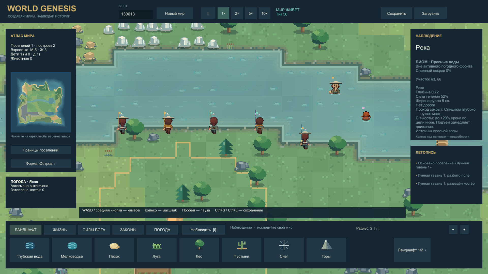
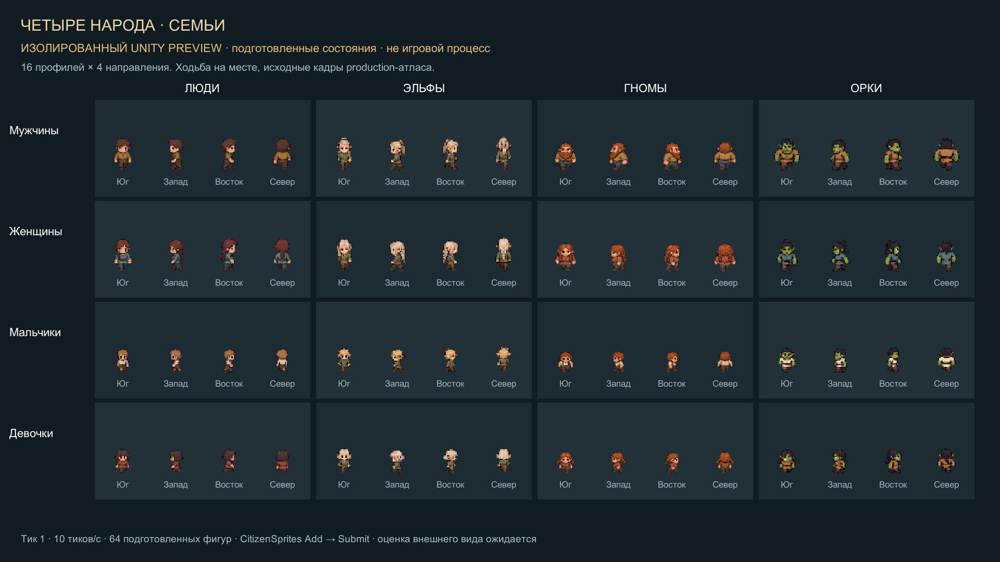
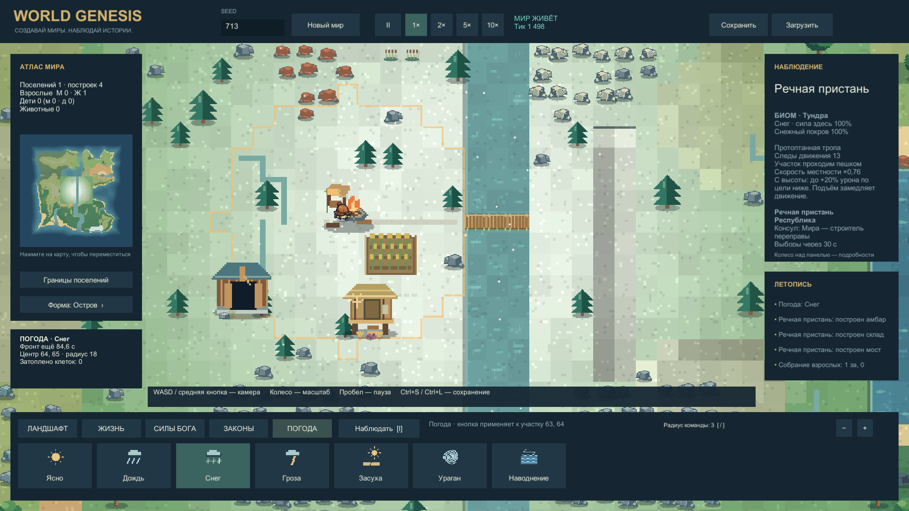
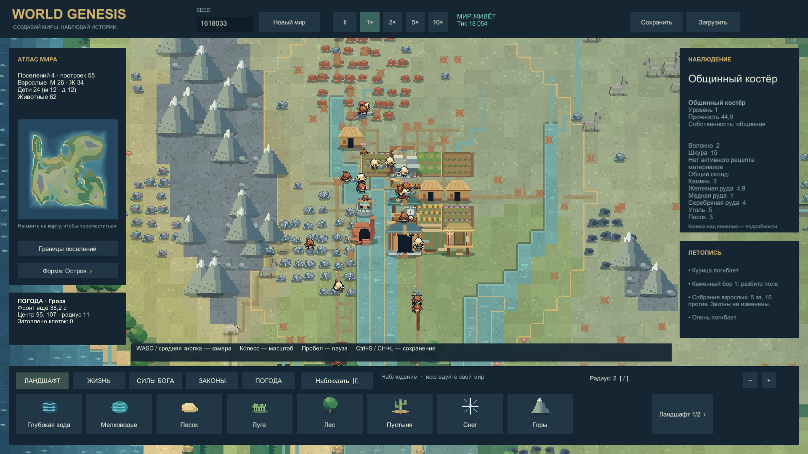
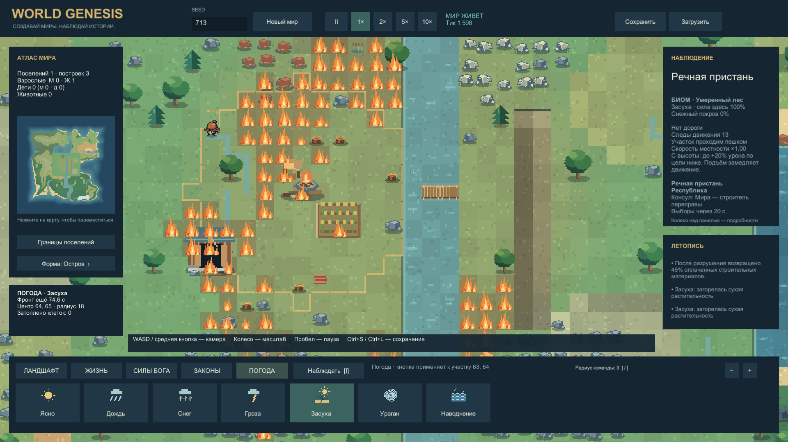
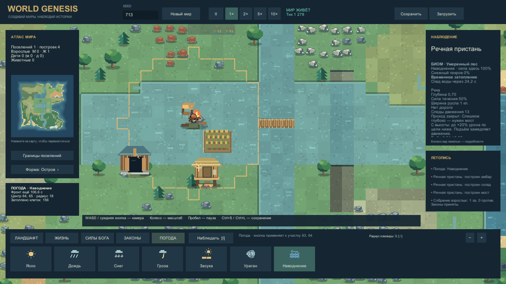
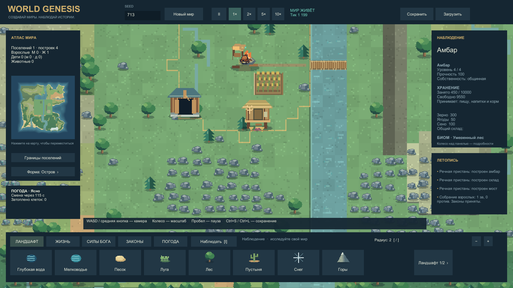

# World Genesis · разработка 0.6.1

Симулятор мира на Unity: создавайте ландшафт, наблюдайте за поселениями и меняйте их судьбу силами природы.

**[Новое: рыбалка, реки и берег — 4 кадра и клип](Docs/Development/FISHING_RIVERS_GALLERY.md)** · [Отчёт 0.6.1](Docs/Development/FISHING_RIVERS_REPORT.md) · [Виды рыбы и рецепты снастей](Docs/Design/FISHING.md).

Пять грейдов удочек, десять видов рыбы, редкая еда, жемчуг и древняя чешуя. Жители ловят, несут улов в амбар и изготавливают улучшенные снасти после исследований. На мелководье видна только надводная часть тела; на мосту — полный силуэт. Берега получили влажную кромку, гальку и отмели, реки — движение по направлению течения.

Карта и грейды на этом кадре подготовлены для сравнения. Обычный старт и условия съёмки указаны в галерее. Windows 0.6.1 собран и проверен локально; отдельный GitHub Release 0.6.1 пока не создан.

**[Скачать Windows 0.5.1-alpha](https://github.com/MixonUP/world-genesis/releases/tag/v0.5.1-alpha)** · **[Галерея: 7 разных игровых кадров](Docs/Development/GALLERY_0_5.md)** · [Управление](Docs/Development/PLAY_GUIDE.md)

[Новые жители: галерея рас, одежды и анимаций](Docs/Development/ORIGINAL_CITIZENS_GALLERY.md) · [Отчёт 0.6](Docs/Development/ORIGINAL_CITIZENS_REPORT.md). Четыре расы, мужчины, женщины, мальчики и девочки; четыре направления ходьбы и одежда семи гражданских ролей. Рабочие инструменты и жесты используют состояние симуляции. Это собственный арт; [прежняя доска выбора](Docs/Research/CREATURE_ASSET_SELECTION.md) сохранена как история исследования.

Галерея показывает подготовленные фигуры через игровой renderer, с ходьбой на месте. 256 исходных ячеек — это кадры ходьбы, а не 256 разных действий. Полное равенство анимациям WorldBox пока не достигнуто; точное количество оригинальных клипов не установлено. Последний опубликованный Windows-релиз по ссылке выше — 0.5.1; новые исходники находятся в этой ветке.

Подготовленная игровая сцена: снег вызван командой, температура участка снижена для проверки накопления покрова. Это настоящий кадр игры; подробности помощи указаны в галерее.

## Новое в 0.5

**Обновление 0.5.1: снабжение костра.** Один общинный костёр постепенно создаёт 25 порций еды и 25 единиц воды за хозяйственные сутки. Сутки — 10 минут при 1×; норма жителя, включая ребёнка, — 1 еда и 1 вода. Костёр пополняет запас до 50/50; собранная сверх этого еда сохраняется. При 30 жителях базовая нехватка составляет 5/5 в сутки. Еда и вода списываются при фактическом питании; до источника нужно дойти. [Правила, проверки и кадры](Docs/Development/SUBSISTENCE_REPORT.md).

- Десять биомов, болота, холмы, овраги и возвышенности; реки с глубиной и течением, ручьи, озёра и устья.
- Сменяемая погода: дождь, снег, гроза, засуха и ураган. Пожары распространяются, дождь их тушит, снег замедляет жителей, засуха мешает росту. Ураган повреждает постройки и жителей, паводок затапливает низины и затем отступает.
- Жители натаптывают тропы, исследуют дороги и строят мосты настоящими доставками материалов. Местность, склон, глубина и течение влияют на маршрут и скорость.
- Поселения предпочитают доступные возвышенности. Правители могут перестраивать застройку ради школы, дороги или башни; разрушение возвращает случайные 10–50% оплаченных строительных материалов.
- Раздельные склады материалов и пищевые амбары: 1000 / 2500 / 5000 / 10000 единиц. Редкие соляные месторождения доступны добыче и караванам.

Из предыдущих версий: мужчины, женщины и дети, потребности и профессии; настроение, образование, религии, три формы правления и восстания; поля, пастбища, дикие и домашние животные; физическая ноша, корзины, вьючные животные и телеги плотника на 150 единиц; межпоселенческие караваны. Реализована 31 технология, полный дизайн содержит 70.

## Галерея

| Развившееся поселение | Засуха и пожар |
| --- | --- |
|  |  |
| **Наводнение** | **Амбар четвёртого уровня** |
|  |  |

[Все 7 кадров с пояснениями](Docs/Development/GALLERY_0_5.md), включая общий вид мира и ураган. [Движение урагана](Evidence/Captures/20261012-170743-climate-hurricane-final.mp4) · [Движение пожара](Evidence/Captures/20261012-171427-climate-fire-final.mp4). Погодные и складские сцены подготовлены для проверки; естественное поселение развилось без выдачи технологий и ресурсов.

## Запуск

Распакуйте Windows ZIP целиком и запустите `WorldGenesis.exe`, сохранив рядом папку данных и DLL. Текущая локальная сборка: `Builds/Windows-0.6.1/WorldGenesis.exe`.

WASD / средняя кнопка — камера; колесо — масштаб; ЛКМ — инструмент; I — наблюдение; пробел — пауза; Home — весь мир; Ctrl+S / Ctrl+L — сохранение / загрузка; M — звук; F12 — снимок. Во вкладке «ПОГОДА» выберите явление для наблюдаемого участка.

Разработка: `WorldGenesis/`, **Unity 6000.0.45f1**, сцена `Assets/_Project/Scenes/Main.unity`. [Команды и инструменты](Tools/README.md).

## Проверки и границы

**0.6.1: 229 EditMode и 41 PlayMode проверка прошли; Windows — 0 ошибок и предупреждений.** Два естественных мира по 600 секунд дали 64/32 улова с доставкой, без нарушения инвариантов. За это время осталась примитивная снасть: естественная прогрессия 1→5 ещё не подтверждена. Нативный профиль 1000 существ / 30 с / 1920×1080: средние 107.22 FPS, p99 41.67 мс; пересечения плотной толпы и редкие длинные кадры остаются. [Доказательства и ограничения](Docs/Development/FISHING_RIVERS_REPORT.md).

**0.5.1: 215 EditMode и 20 PlayMode проверок прошли; сборка без ошибок и предупреждений.** В отдельном пятисуточном прогоне один костёр поддержал 25 жителей без других источников еды и воды: все выжили, 30 000 состояний мира валидны. Начальный мир подготовлен, рождения, старение и бедствия отключены. Результаты интерфейса и Player — в [отчёте](Docs/Development/SUBSISTENCE_REPORT.md).

Исторические проверки 0.5.0: два естественных прогона по 30 симуляционных минут, 360 проверок мира и 3 390 776 проверок ноши. В одном мире вымерло поселение; частота естественного строительства мостов пока не подтверждена. После изменения расхода эти результаты не доказывают баланс 0.5.1.

Исторический профиль 0.5.0: 1000 жителей / 30 секунд при урагане: средние 121.67 FPS, p99 34.72 мс, максимум 90.28 мс на Ryzen 7950X / RTX 4090. Есть отдельные рывки; это не 30-минутная проверка стабильности Player. [Отчёт 0.5](Docs/Development/TRANSPORT_REPORT.md) · [визуальное ревью](Docs/Development/CLIMATE_NATIVE_REVIEW.md) · [приёмка](Docs/ACCEPTANCE.md).

Погода использует один локальный фронт и до 192 временно затопленных клеток. Пока нет сезонов, полной гидродинамики, полной цепочки металла/монет, вооружения армий и осад. Караваны обменивают материалы 1:1; торговля агропродуктами и динамические цены впереди. Художественное качество, силуэт вихря и плотная толпа требуют дальнейшей работы.

[Индекс проекта](Docs/00_INDEX.md) · [Состояние](Docs/STATE.md) · [Архитектура](Docs/ARCHITECTURE.md) · [Исследования](Docs/Research/README.md) · [Происхождение арта](SourceAssets/manifest.csv) · [Роли агентов](Docs/Development/AGENT_ROLES.md).

World Genesis — самостоятельная реализация с WorldBox как референсом, не официальный продукт. Полнота оригинала и художественное принятие пользователем пока не достигнуты.
