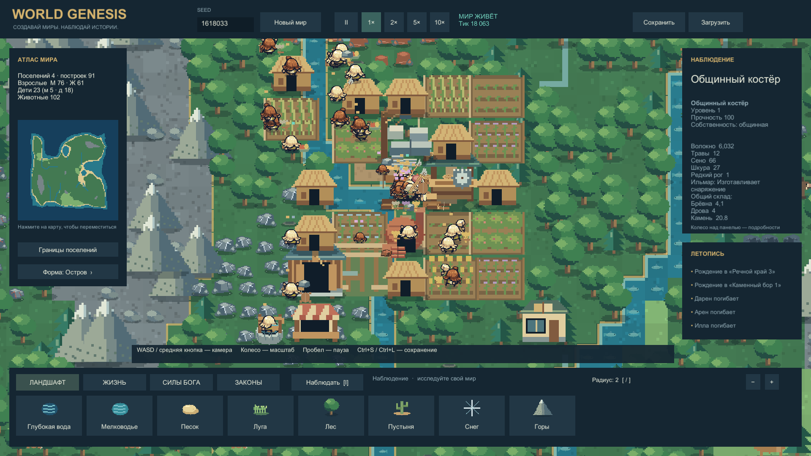

# World Genesis · Unity

Играбельная Unity-альфа симулятора бога по референсу [WorldBox](https://store.steampowered.com/app/1206560/WorldBox__God_Simulator/). **0.4.0** добавляет общество, исследования, сельское хозяйство, животных и физические караваны.

Seed1618033 после30 минут симуляции без выдачи ресурсов и технологий; камера выбрана автоматически. Полнота WorldBox и итоговое художественное качество ещё не достигнуты.

## Что работает

- Мир по seed, биомы, реки, рыба, кисти ландшафта и силы бога.
- Жители, семьи/дети, потребности, настроение, доверие, обучение, редкие мастера и религии.
- Феодальное правление, республика и теократия; правители, законы/налог, голосования взрослых, кризисы и восстания.
- 28 действующих технологий с убывающим вкладом участников; мирный старт и временная гражданская самозащита.
- 11 видов месторождений, добыча, доставка, истощение/восстановление и базовая переработка.
- Пшеница, лён, ягоды, травы и сено; пастбища, приручение, разведение, охота и13 видов животных.
- Колодцы, склады, магазины, школы, дороги, деревянные стены/ворота и жильё пяти уровней.
- Руки1, корзины10/15/25, осёл50, лошадь75, сумки+25. **Плотник делает телегу вместимостью150**:12досок+4волокна+2шкуры,8рабочих секунд, исследование телег и упряжное животное.
- Пешие и оснащённые караваны до4взрослых с реальным грузом, бесплатной помощью либо оплатой едой; межгородской бартер материалов и натуральный налог.
- Пивоварение из доставленного зерна/топлива/воды и последствия употребления; русский UI, миникарта, летопись и сохранения.

## Запуск

[Скачать Windows 0.4.0-alpha](https://github.com/MixonUP/world-genesis/releases/tag/v0.4.0-alpha). Распакуйте ZIP целиком и запустите `WorldGenesis.exe`, сохранив рядом `WorldGenesis_Data` и DLL. Локально: `Builds/Windows-0.4.0/WorldGenesis.exe`. Стадия публикации — [STATE](Docs/STATE.md).

Разработка: `WorldGenesis/`, **Unity6000.0.45f1**, сцена `Assets/_Project/Scenes/Main.unity`. Проверенные команды — [Tools](Tools/README.md).

WASD/средняя кнопка — камера; колесо — масштаб; ЛКМ — инструмент; I — наблюдение; пробел — пауза; Home — весь мир; Ctrl+S/Ctrl+L — save/load; M — звук; F12 — снимок. Колесо над правой панелью прокручивает подробности. [Руководство](Docs/Development/PLAY_GUIDE.md).

## Проверки и границы

**119 Unity EditMode и10 PlayMode прошли; сборка без ошибок/предупреждений.** Два естественных прогона по30 минут:161/62гражданина,121/34корзины,5.32млн проверок ноши. Во втором мире одно поселение вымерло; баланс требует дальнейшей настройки. Отдельный native-профиль1000существ/30секунд:131.63FPS,p99=13.89мс на Ryzen7950X/RTX4090. Это не30-минутный native-тест стабильности.

[Полный отчёт0.4](Docs/Development/SOCIETY_REPORT.md) · [клип каравана](Evidence/Captures/20261012-151758-rural-caravan.mp4) · [приёмка](Docs/ACCEPTANCE.md). Клип использует подготовленную сцену с выданными технологиями и материалами; телега изготовлена настоящим рецептом.

Караваны пока обменивают материалы1:1, без досок и агропродуктов. Нет полной чеканки/динамических цен, вооружения армий и осад, всех ремесленных профессий или внешней LLM. Наложение толпы и масштаб некоторых животных требуют доработки.

Спроектированы83товара,88рецептов,38зданий×5уровней и67технологий. Каталоги **не означают реализацию всего содержания в игре**. [Экономика](Docs/Design/ECONOMY_AND_PROFESSIONS.md) · [технологии](Docs/Design/TECHNOLOGY_TREE.md) · [караваны](Docs/Design/CARAVAN_RUNTIME.md).

- [Индекс](Docs/00_INDEX.md), [состояние](Docs/STATE.md), [правила](AGENTS.md), [роли агентов](Docs/Development/AGENT_ROLES.md).
- [Исследования](Docs/Research/README.md), [происхождение арта](SourceAssets/manifest.csv), отчёты [0.3](Docs/Development/RESOURCES_REPORT.md), [0.2](Docs/Development/CITIZENS_REPORT.md), [0.1](Docs/Development/ALPHA_REPORT.md).

World Genesis — самостоятельная реализация с рабочим названием, не официальный WorldBox. Ресурсы оригинала не извлекались. Художественное принятие и сравнительный тест с Claude не проводились.
