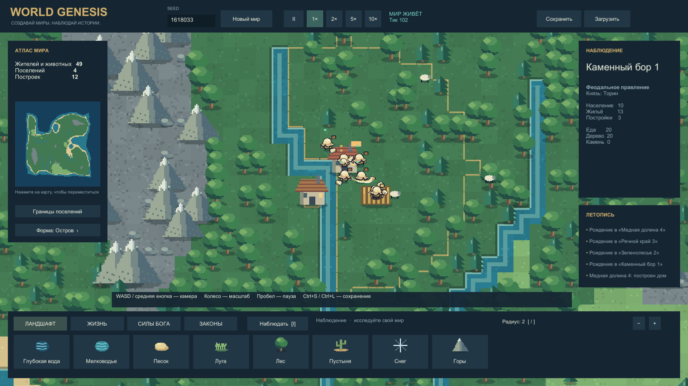

# World Genesis · Unity

Играбельная Unity-альфа симулятора бога по референсу [WorldBox](https://store.steampowered.com/app/1206560/WorldBox__God_Simulator/). Создавайте ландшафт, заселяйте мир, наблюдайте развитие поселений и вмешивайтесь силами бога. Итерация **0.2.0** улучшает жителей и добавляет формы правления и временное ополчение.

Кадр из игры, seed 1618033. Камера автоматически приближена к поселению; графика отрисована Unity. Постоянных воинов на старте нет. Полное соответствие WorldBox и итоговое художественное качество ещё не достигнуты.

## Что работает

- Генерация по seed: остров, архипелаг, континент; биомы, климат, реки и ресурсы.
- Восемь кистей ландшафта, четыре народа, овцы и волки.
- Передвижение, добыча и доставка ресурсов, голод, строительство, рождение и смерть.
- Анимированные люди из старого CC0 Tiny Swords; еда, отдых, общение, бегство от опасности.
- Феодальная форма, республика или теократия, живой правитель и его смена.
- Временное гражданское ополчение при близкой угрозе с возвращением к работе; профессиональный найм ещё недоступен.
- Огонь, дождь, молния, метеор, лечение, благословение и чума; пять законов мира.
- Русский интерфейс, миникарта, инспектор, летопись, пауза и ускорение.
- Проверяемые сохранения с резервной копией, процедурная графика, звук и эффекты.

## Запуск

Готовые выпуски: [GitHub Releases](https://github.com/MixonUP/world-genesis/releases). Распакуйте Windows ZIP целиком и запустите `WorldGenesis.exe`; папка `WorldGenesis_Data` и библиотеки должны остаться рядом. Актуальная локальная сборка: `Builds/Windows-0.2.0/WorldGenesis.exe`; дата и статус публикации указаны в [STATE](Docs/STATE.md).

Для разработки добавьте папку `WorldGenesis/` в Unity Hub и откройте в **Unity 6000.0.45f1**. Сцена `Assets/_Project/Scenes/Main.unity`. Из корня репозитория сборка запускается командой `powershell -File Tools/Project.ps1 -Action Build`.

WASD / средняя кнопка — камера; колесо — масштаб; ЛКМ — инструмент; I — наблюдение; пробел — пауза; Home — весь мир; Ctrl+S / Ctrl+L — сохранить / загрузить; M — звук; F12 — снимок. [Подробное управление](Docs/Development/PLAY_GUIDE.md).

## Проверки и процесс

**47 проверок ядра, 33 Unity EditMode и 5 PlayMode прошли.** Windows Player собран без ошибок и предупреждений. Точная область проверок, native-кадры, клип, профиль и ограничения — [отчёт 0.2.0](Docs/Development/CITIZENS_REPORT.md) и [приёмка](Docs/ACCEPTANCE.md). История первой версии сохранена в [отчёте 0.1.0](Docs/Development/ALPHA_REPORT.md).

Спроектированы 31 профессия, 52 товара, 55 рецептов, 31 тип зданий с пятью уровнями, 12 видов фауны, торговые караваны и 44 технологии. CSV проходят структурную и математическую проверку, но **полная экономика и исследования ещё не реализованы в игре**. Правило убывания вклада действует для всех групп населения; постоянные войска в проекте требуют исследования, физического комплекта и обучения. [Экономика](Docs/Design/ECONOMY_AND_PROFESSIONS.md) · [Технологии](Docs/Design/TECHNOLOGY_TREE.md) · [ИИ жителей](Docs/Design/NPC_INTELLIGENCE.md).

Флоты, транспортная колонизация, развитая дипломатия, восстания, большое разнообразие существ и художественная доводка ещё впереди. Длительная стабильность пока не подтверждена 30-минутным прогоном. Сравнение качества с Claude не проводилось.

- [Индекс проекта](Docs/00_INDEX.md), [текущее состояние](Docs/STATE.md), [карта функций](Docs/FEATURE_MAP.md).
- [Правила агентов](AGENTS.md), [реальные роли субагентов](Docs/Development/AGENT_ROLES.md), [исследования и формулы](Docs/Research/README.md).
- [Инструменты](Tools/README.md), [происхождение ассетов](SourceAssets/manifest.csv).

World Genesis — рабочее название самостоятельной реализации. Это не официальный WorldBox; ресурсы оригинала не извлекались.
