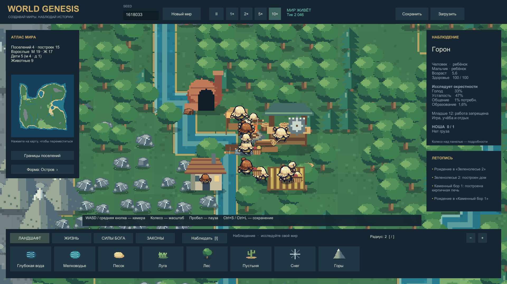

# World Genesis · Unity

Играбельная Unity-альфа симулятора бога по референсу [WorldBox](https://store.steampowered.com/app/1206560/WorldBox__God_Simulator/). Версия **0.3.0** добавляет добываемые месторождения, переработку, бартер, законы правителя и разделение жителей по полу и возрасту.

Seed1618033, тик2046, ускорение10×. Автоматическая камера выбрала ребёнка после естественного рождения; графика отрисована Unity. Полнота WorldBox и итоговое художественное качество ещё не достигнуты.

## Что работает

- Три пресета мира по seed, биомы, реки, кисти ландшафта и силы бога.
- Четыре народа, овцы и волки; потребности, движение, рождение, болезни и смерть.
- 11 видов ресурсных узлов с истощением/восстановлением; ноша до одной единицы, настоящая доставка к станции.
- Костёр, лесопилка, каменная мастерская и печь: доски, дрова, блоки, плитка и кирпичи.
- Раздельные общие/личные запасы, подарки и бартер с натуральным налогом; на одну сделку существующие товары списываются один раз.
- Мужчины, женщины и дети; отдельные силуэты людей, детские занятия/учёба, лёгкий труд подростков12–15 по закону правителя.
- Феодальная форма, республика или теократия; живой правитель выбирает распределение, налог, детский закон и приоритет добычи.
- Временная гражданская самозащита; постоянных воинов/бесплатной брони на старте нет.
- Русский UI с прокруткой инспектора, миникарта, летопись, скорости и проверяемые сохранения.

## Запуск

Готовые сборки — [GitHub Releases](https://github.com/MixonUP/world-genesis/releases). Распакуйте Windows ZIP целиком и запустите `WorldGenesis.exe`, сохранив рядом `WorldGenesis_Data` и DLL. Локально: `Builds/Windows-0.3.0/WorldGenesis.exe`. Точная стадия публикации — [STATE](Docs/STATE.md).

Для разработки откройте `WorldGenesis/` в **Unity6000.0.45f1**, сцена `Assets/_Project/Scenes/Main.unity`. `powershell -File Tools/Project.ps1 -Action Build` запускает проверенный сборочный сценарий.

WASD/средняя кнопка — камера; колесо — масштаб; ЛКМ — инструмент; I — наблюдение; пробел — пауза; Home — весь мир; Ctrl+S/Ctrl+L — save/load; M — звук; F12 — снимок. Колесо над правой панелью прокручивает реальные запасы/указы. [Руководство](Docs/Development/PLAY_GUIDE.md).

## Проверки и границы

**68 проверок ядра,57 Unity EditMode и7 PlayMode прошли.** Windows build:0ошибок/0предупреждений. Обычный мир за4500тиков совершил32подарка и15бартеров; при этом239409проверок не обнаружили перегруза жителей. Native-профиль1000существ/30секунд:131.87FPS,p99≈13.89мс на Ryzen7950X/RTX4090. [Полный отчёт0.3](Docs/Development/RESOURCES_REPORT.md) · [клип настоящей доставки](Evidence/Captures/20261012-133008-resources-log-delivery-release.mp4) · [приёмка](Docs/ACCEPTANCE.md).

Бартер пока складской и1:1; еда/доски частично остаются общинными агрегатами. Караваны, плавка/чеканка/кузница, исследования, полные профессии и автоматические ресурсные войны ещё впереди. Различия сырья между поселениями уже существуют. Наложение жителей возле одной фермы остаётся видимым ограничением;30-минутный native-прогон и вся матрица нагрузок ещё не закрыты.

Спроектированы77товаров,86рецептов,33профессии,33здания×5уровней,54технологии и [32решения правителя](Docs/Design/RULER_DECISIONS.md). Эти каталоги **не означают реализацию всего содержания в игре**. [Экономика](Docs/Design/ECONOMY_AND_PROFESSIONS.md) · [Демография/обмен](Docs/Design/RESIDENT_EXCHANGE_AND_DEMOGRAPHY.md) · [Технологии](Docs/Design/TECHNOLOGY_TREE.md) · [ИИ](Docs/Design/NPC_INTELLIGENCE.md).

- [Индекс](Docs/00_INDEX.md), [текущее состояние](Docs/STATE.md), [карта функций](Docs/FEATURE_MAP.md).
- [Правила](AGENTS.md), [фактические роли субагентов](Docs/Development/AGENT_ROLES.md), [исследования](Docs/Research/README.md).
- [Инструменты](Tools/README.md), [происхождение арта](SourceAssets/manifest.csv), отчёты [0.2](Docs/Development/CITIZENS_REPORT.md) и [0.1](Docs/Development/ALPHA_REPORT.md).

World Genesis — самостоятельная реализация с рабочим названием, не официальный WorldBox. Ресурсы оригинала не извлекались. Художественное принятие и сравнительный тест с Claude не проводились.
