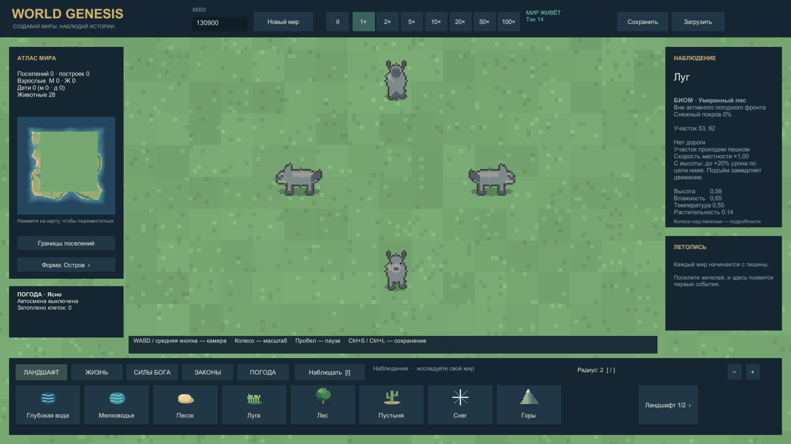
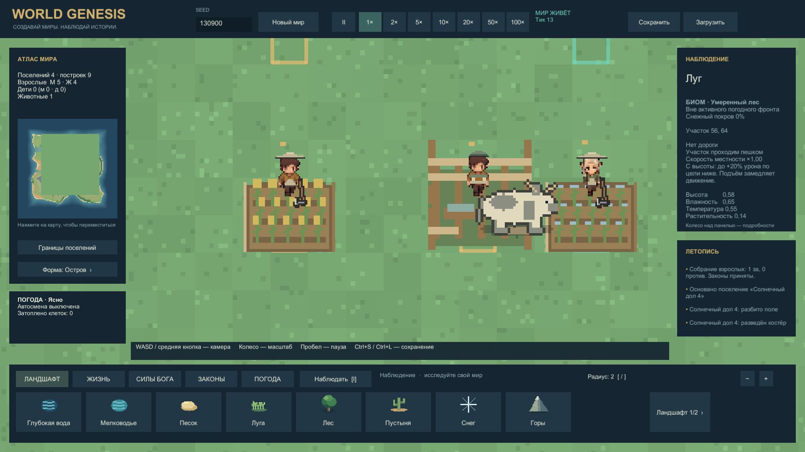

# World Genesis

Процедурная песочница бога на Unity: четыре народа, живые поселения, ресурсы, общество и погода. Самостоятельная реализация с WorldBox как референсом; полный объём коммерческой игры ещё не достигнут.

**0.9 — скорость, животные и музыка.** [Windows-сборка](https://github.com/MixonUP/world-genesis/releases/tag/v0.9.0-alpha) · [кадры и движение](Docs/Development/SPEED_FAUNA_GALLERY.md) · [проверки и ограничения](Docs/Development/SPEED_FAUNA_REPORT.md).

## В этой версии

- Скорости **20×, 50×, 100×**, ограниченный бюджет расчёта и показ фактического ускорения. Поиск недостижимых путей оптимизирован; доступная скорость зависит от нагрузки.
- Все 13 видов наземных животных имеют четыре стороны и четыре фазы ходьбы. Лес пополняется реже, размножение требует пары, корма и подходящей плотности.
- Жители видны поверх полей и пастбищ. Корона закреплена на голове действующего правителя. Постройки требуют сухого фундамента; порт размещается на берегу.
- Три пользовательских трека **Dawn over the Settlement**, около 11 минут музыки, переходы по 5 секунд. Темп не меняется при ускорении мира; на паузе музыка приглушается, **M** отключает звук.

| Животные в четырёх направлениях | Жители на полях и пастбище |
| --- | --- |
|  |  |

[▶ Ходьба оленей — 7 секунд из игры](Evidence/Captures/20261014-014142-fauna-walking-final.mp4). Животные и поля специально расставлены для визуальной проверки; условия описаны в галерее. Это не доказательство естественного развития.

## Что уже есть

Мужчины, женщины и дети; четыре народа, одежда, нужды, настроение и обучение. Правители, три формы правления, решения и восстания. Поля, пастбища, дикие и домашние животные, рыбалка с пятью грейдами снастей. Залежи, восстановление ресурсов, физические грузы, корзины, вьючные животные, телеги на150единиц и караваны. Дороги, мосты, рельеф, реки, биомы, погода и бедствия. Раздельные склады и амбары, костёр с едой и водой на25жителей.

Семь мастерских и27промышленных рецептов; физические двери и работа внутри зданий. Инструменты, одежда и мебель действительно используются. Плотник делает осадные комплекты после исследований; их боевое развёртывание ещё не готово.

Порт, верфь, управление и соединённые склады **5000 → 10000 → 20000**. Рыбацкие, транспортные, торговые и боевые суда; морские странники с конечным трюмом до 20000. Реальные экипажи, провизия, рейсы, нападение и захват. Моряк после высадки возвращается к обычной работе. [Море и рынок 0.8](Docs/Development/MARITIME_REPORT.md).

[Жители](Docs/Development/ORIGINAL_CITIZENS_GALLERY.md) · [рыбалка и реки](Docs/Development/FISHING_RIVERS_GALLERY.md) · [производство и здания](Docs/Development/PRODUCTION_BUILDINGS_GALLERY.md) · [погода](Docs/Development/GALLERY_0_5.md).

## Запуск

Распакуйте Windows ZIP целиком и запустите WorldGenesis.exe, сохранив рядом папку данных и DLL. Локальная сборка: Builds/Windows-0.9.0/WorldGenesis.exe.

WASD / средняя кнопка — камера; колесо — масштаб; ЛКМ — инструмент; I — наблюдение; пробел — пауза; Home — весь мир; Ctrl+S / Ctrl+L — сохранение / загрузка; M — звук; F12 — снимок. В наблюдении выберите корабль для вкладок «Рейс», «Трюм», «Команда». [Подробное управление](Docs/Development/PLAY_GUIDE.md).

Разработка: WorldGenesis/, Unity **6000.0.45f1**, сцена Assets/_Project/Scenes/Main.unity. [Команды](Tools/README.md).

## Проверки и известные границы

**356 EditMode и 65 PlayMode прошли. Windows — 0 ошибок и предупреждений.** Три музыкальных ресурса загрузились, воспроизведение идёт с pitch=1 независимо от скорости мира. Художественное прослушивание итогового микса агентом не выполнено.

Нативный профиль 1920×1080, Ryzen 7950X/RTX4090, по 30 секунд: на 100 жителях фактические **20× / 50× / 74×** при запросах 20× / 50× / 100×. На 1000 жителях запрос 100× дал около **8,6× и 26–28 FPS**. Полные 100× на большой толпе не достигнуты. Это подготовленные нагрузки с сохранённым населением; методика и все значения — в [отчёте](Docs/Development/SPEED_FAUNA_REPORT.md).

Измерение обычной экономики 0.8 остаётся актуальным ограничением: два мира по 1800 секунд завершили 23 и 2 промышленные партии, но инструменты, денежный оборот и порты за это время не появились. [Причины и следующий шаг](Docs/Development/MARKET_PROGRESS_REPORT.md).

50технологий исполняются из79проектных. Следующие задачи: естественная металлургия и денежная торговля, стратегия морского ИИ, разведение судов у причалов и в бою, боевые осады, комнаты со снятием крыши. Плотность толпы и художественная детализация требуют доводки. Технический PASS не означает художественного принятия пользователем.

[Индекс](Docs/00_INDEX.md) · [состояние](Docs/STATE.md) · [архитектура](Docs/ARCHITECTURE.md) · [исследования](Docs/Research/README.md) · [происхождение арта](SourceAssets/manifest.csv) · [роли агентов](Docs/Development/AGENT_ROLES.md).
