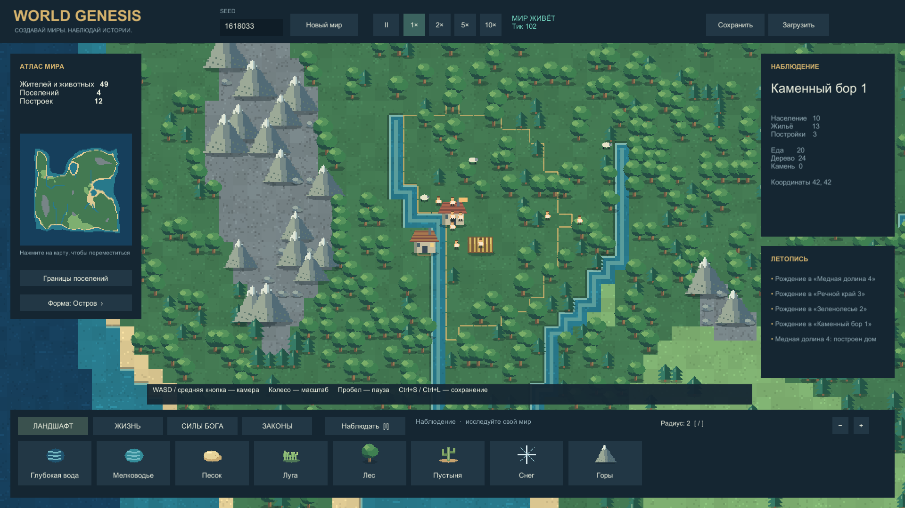

# World Genesis · Unity

Первая играбельная альфа симулятора бога по референсу [WorldBox](https://store.steampowered.com/app/1206560/WorldBox__God_Simulator/). Создавайте ландшафт, заселяйте мир, наблюдайте развитие поселений и вмешивайтесь силами бога.

Кадр из игры, seed 1618033. Камера автоматически приближена к поселению; графика отрисована Unity. Это первая альфа, полное соответствие WorldBox ещё не достигнуто.

## Что работает

- Генерация по seed: остров, архипелаг, континент; биомы, климат, реки и ресурсы.
- Восемь кистей ландшафта, четыре народа, овцы и волки.
- Передвижение, добыча и доставка ресурсов, голод, строительство, рождение и смерть.
- Огонь, дождь, молния, метеор, лечение, благословение и чума; пять законов мира.
- Русский интерфейс, миникарта, инспектор, летопись, пауза и ускорение.
- Проверяемые сохранения с резервной копией, процедурная графика, звук и эффекты.

## Запуск

Готовые выпуски: [GitHub Releases](https://github.com/MixonUP/world-genesis/releases). Распакуйте Windows ZIP целиком и запустите `WorldGenesis.exe`; папка `WorldGenesis_Data` и библиотеки должны остаться рядом.

Для разработки добавьте папку `WorldGenesis/` в Unity Hub и откройте в **Unity 6000.0.45f1**. Сцена `Assets/_Project/Scenes/Main.unity`. Из корня репозитория сборка запускается командой `powershell -File Tools/Project.ps1 -Action Build`.

WASD / средняя кнопка — камера; колесо — масштаб; ЛКМ — инструмент; I — наблюдение; пробел — пауза; Home — весь мир; Ctrl+S / Ctrl+L — сохранить / загрузить; M — звук; F12 — снимок. [Подробное управление](Docs/Development/PLAY_GUIDE.md).

## Проверки и процесс

32 проверки ядра, 18 Unity EditMode и 3 PlayMode прошли. Windows Player собран без ошибок и предупреждений; настоящие кадры проверены при 1920×1080 и 1280×720. Точная область проверок, профиль и нерешённые пункты — [отчёт альфы](Docs/Development/ALPHA_REPORT.md) и [приёмка](Docs/ACCEPTANCE.md).

Флоты, транспортная колонизация, развитая дипломатия, восстания, большое разнообразие существ и художественная доводка ещё впереди. Длительная стабильность пока не подтверждена 30-минутным прогоном. Сравнение качества с Claude не проводилось.

- [Индекс проекта](Docs/00_INDEX.md), [текущее состояние](Docs/STATE.md), [карта функций](Docs/FEATURE_MAP.md).
- [Правила агентов](AGENTS.md), [реальные роли субагентов](Docs/Development/AGENT_ROLES.md), [исследования и формулы](Docs/Research/README.md).
- [Инструменты](Tools/README.md), [происхождение ассетов](SourceAssets/manifest.csv).

World Genesis — рабочее название самостоятельной реализации. Это не официальный WorldBox; ресурсы оригинала не извлекались.
