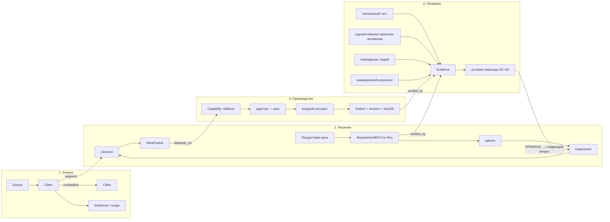
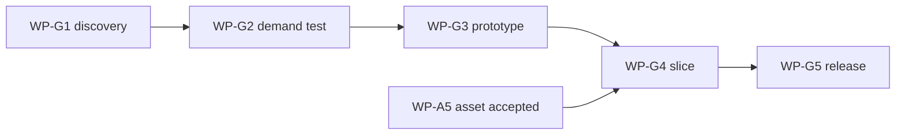

# Исследовательский контур AI Game Studio — архитектура

Версия 0.1 · 13.11.2026 · автор: Claude (второй исполнитель) · база `3fdbd6f`.
Статус документа: **proposed**. Сейчас реализован только локальный реестр и валидатор (`validator.py`). Всё остальное в этом документе — спецификация интерфейсов, а не работающие интеграции.

## 1. Зачем этот контур

Контур должен отвечать на восемь вопросов о любом решении студии:

| Вопрос | Где ответ в данных | Чем получить |
|---|---|---|
| Какое решение принимаем? | `Decision` (`decision`, `decision_status`) | `query why DEC-…` |
| На каких утверждениях стоит? | рёбра `supports` Claim/Evidence → Decision | `query why` |
| Откуда утверждения? | `Claim.source_refs` → `Source` (study_depth, reliability, accessed) | `query why` |
| Что проверено нами? | `Evidence` с `evidence_status=executed`, не `synthetic` | отчёт `check`, `requirements[*].evidence` |
| Какое требование затронуто? | `RequirementRef` (существующий Cxx-Rxx) + `verified_by` | `query requirement-gaps` |
| Какой skill/инструмент выполнит следующий шаг? | `Capability` + `WorkPacket` + `depends_on` | `query declared-only`, `execution_order` |
| Чем проверить результат? | `RequirementRef.accepted_evidence_classes`, `WorkPacket.evidence_plan` | отчёт `check` |
| Что теряет актуальность после изменения? | обратный обход `derived_from/depends_on/produced_by/verified_by/implements` + `supports` | `query impact <id>` |

Ответы не сводятся к одному рейтингу. Это **пять разных фактов**, и они хранятся в разных полях:

1. **декларация возможности**: `Capability.declared`;
2. **доступность инструмента**: `Capability.available` (`verified_today/historical/not_checked/unavailable`) и `invocation_verified`;
3. **выполненный benchmark**: `Capability.benchmarked` и `Experiment` со статусом `completed`;
4. **принятие результата**: `Artifact.lifecycle=accepted` плюс `Evidence` класса `human_art_acceptance` или `human_playtest`;
5. **право на внешнее действие**: `Capability.external_action_authorized`. Это только запись: валидатор её не подтверждает. Деньги и реальная авторизация остаются за runner/executor и пользователем.

## 2. Четыре слоя

| Слой | Канонические данные | Интерфейс к следующему слою | Реализовано сейчас |
|---|---|---|---|
| Знания | `Source`, `Claim`, рёбра `contradicts/derived_from/supersedes` | `supports` Claim → Decision | да: контракт, проверка ссылок, противоречия, unknown |
| Решения | `RequirementRef`, `Experiment`, `Decision`, `WorkPacket` | `depends_on` (DAG), `implements` | да: DAG, предрегистрация критерия, пересечение ownership |
| Производство | `Capability`, `Artifact` | `produced_by`, `verified_by` | частично: статусы и права; **адаптеры только spec** (R09) |
| Проверка | `Evidence` | вердикт `PASS/FAIL/OPEN` для требования | да: класс, ревизия, срок, synthetic, independence |

**Граф знаний и исполнимый DAG — разные вещи.** В графе знаний допустимы обратные связи разных типов. Например: Evidence `supports` Claim → Claim `supports` Decision → WorkPacket `derived_from` Decision → Artifact `produced_by` WorkPacket → Artifact `verified_by` Evidence. Валидатор такие петли не отвергает; это проверяет тест `test_knowledge_feedback_loop_is_accepted`. Циклом считаются только две вещи:
- цикл `depends_on`: ошибка `DEPENDENCY_CYCLE`, порядок работ не строится (`execution_order = null`);
- цикл `derived_from/supersedes`: ошибка `PROVENANCE_CYCLE`, такое происхождение невозможно по времени (семантика PROV-O, `SRC-W3C-PROV-O`).

## 3. Статусы, которые нельзя смешивать

| Поле | Значения | Что означает |
|---|---|---|
| `record_status` (любая запись) | draft/active/stale/superseded/withdrawn | жизненный цикл записи |
| `Source.study_depth` | not_accessed → metadata → … → full_text → reproduced | насколько изучен источник |
| `Source.relevance` | 1.2 / 1.0 / 0.7 / null | категориальный приоритет пользователя, **не** вероятность и **не** надёжность |
| `Source.reliability` | primary/secondary/self_report/vendor_claim/unknown | тип происхождения |
| `Claim.verification` | unverified/source_read/cross_checked/reproduced/refuted | что сделано с утверждением |
| `Evidence.evidence_status` | prepared/executed/historical_import/failed_to_run | было ли действие выполнено нами сейчас |
| `Evidence.result` | PASS/FAIL/UNKNOWN | результат критерия |
| вердикт требования (отчёт) | PASS/FAIL/OPEN | вычисляется, не вводится руками |
| `Artifact.lifecycle` | prepared/built/verified/accepted | состояние артефакта |
| `Artifact.license.status` | verified/declared/unknown/restricted/not_applicable | права. Проверка требований ≠ юридическое заключение (`legal_opinion`) |

## 4. Блоки R00–R11

Общие правила для всех блоков. Владелец означает роль; один исполнитель может совмещать роли, но самопроверка не называется независимым review. Связи с требованиями даны по фактическим ID каталога `3fdbd6f`; полная матрица — [COMPONENT_TRACEABILITY.md](COMPONENT_TRACEABILITY.md). «Следующий эксперимент» везде **proposed**: ни один не выполнялся.

### R00 — Исходные условия и доступность

- **Назначение:** зафиксировать цель, движок/версию, платформу, ограничения пользователя, права доступа, доступные skills/tools и историческую приёмку до любого решения.
- **Вопросы:** Что объявлено доступным и что реально вызвано сегодня? Какие ограничения пользователя обязательны (окна, деньги, публикация)? Какие исторические PASS относятся к текущей ревизии?
- **Входы → выходы:** AGENTS/CLAUDE/STATE, каталоги skills, toolchain → `Capability` записи + CAPABILITY_MATRIX + список пробелов.
- **Схема:** `Capability{declared, available, invocation_verified, benchmarked, owner_agent, version, limitations}`; ограничения в `Decision.assumptions`.
- **Владелец:** оркестратор (Codex); для своих инструментов — каждый исполнитель.
- **Cxx-Rxx:** C00-R01, C15-R01.
- **Источники:** `SRC-REPO-HANDOFF`, AGENTS.md, инвентаризация каталогов skills ([INPUT_INVENTORY.md](INPUT_INVENTORY.md)).
- **Метрики:** доля capability с `invocation_verified=true` (шт./шт.); возраст последней проверки (дни).
- **Проверка:** `CAPABILITY_DECLARED_ONLY`, `CAPABILITY_INCONSISTENT`, `CAPABILITY_UNAVAILABLE`.
- **Ошибки и неизвестность:** skill установлен у Codex, но не у Claude; GUI-инструменты под запретом пользователя → `not_checked`, а не `unavailable`.
- **Актуальность:** при смене версии инструмента, аккаунта или ограничений пользователя запись становится `stale`.
- **Потребитель:** R09, оркестратор.
- **Следующий эксперимент:** probe-квитанция для одного CLI (версия + сухой вызов `--help`) с записью Evidence `integrity_check`. Приватные ограничения в публичный пример не переносятся.

### R01 — Источники, видео, GitHub, сообщества

- **Назначение:** реестр первоисточников с автором, версией, датами, методом доступа, глубиной изучения, лицензией и ограничениями.
- **Вопросы:** Что именно мы прочли? Чем подтверждено утверждение? Не выдаём ли метаданные видео за просмотр?
- **Входы → выходы:** URL/пути → `Source` → `Claim` с locator.
- **Схема:** `Source{source_kind, access_method, study_depth, relevance, reliability, rights, video_layers, repository, community}`.
  - Видео: `video_layers{metadata, transcript, viewed_fragments[HH:MM:SS + observed_by/on], reproduced}`. При `study_depth=metadata` таймкоды запрещены.
  - GitHub: `repository{commit_or_tag, license_spdx, dependencies_reviewed, maintenance_note, reproducible_example_run}`. Stars не хранятся.
  - Сообщества: `community{…, contacted:false}`. Запись о контакте отвергается.
- **Владелец:** исследователь.
- **Cxx-Rxx:** C01-R01, C11-R01 (лицензия кода ≠ лицензия весов/датасета).
- **Источники:** [SOURCE_REGISTER.json](SOURCE_REGISTER.json) (14 записей, проверено 13.11); приватная библиотека (150/29/23, не копируется).
- **Метрики:** распределение `study_depth` (шт.); доля утверждений с locator (%); доля источников с неизвестной версией (%).
- **Проверка:** контракт Source; `UNKNOWN_VALUE` для null-полей; команда `sources`.
- **Ошибки:** в библиотеке шкала 1.2/1.0/0.7 смешана с P0/P1 в одном поле (57 из 150 записей). Это противоречие сохранено и разрешено решением `DEC-SEPARATE-RELEVANCE`.
- **Актуальность:** новая версия/commit/лицензия источника → зависимые Claim получают `recheck`; `query impact SRC-…`.
- **Потребитель:** все блоки.
- **Следующий эксперимент:** для четырёх видео пользователя — один из них с transcript и реальными таймкодами, записанными наблюдателем; сравнить с выводами библиотеки.

### R02 — Геймдизайн и опыт игрока

- **Назначение:** превращать принципы и материалы ведущих авторов в проверяемые гипотезы о поведении игрока.
- **Вопросы:** Есть ли интересное решение и читаемая обратная связь? Понимает ли новичок последствие действия без помощи?
- **Входы → выходы:** brief, наблюдения → `Claim(kind=principle|heuristic|coefficient)` → `Experiment` → `Decision`.
- **Схема:** `claim_kind` отличает принцип, жанровую эвристику и конкретный коэффициент; `Experiment.sample{n, unit}`.
- **Владелец:** геймдизайнер; люди-участники для проверки.
- **Cxx-Rxx:** C03-R01, C03-R02, C03-R03, C10-R02, C14-R01.
- **Источники:** главы 02/08 приватной библиотеки. Метрика библиотеки: доля целевых новичков, прошедших цикл без помощи и объяснивших последствие (успехи/наблюдения).
- **Метрики:** core-path success (шт./шт.); time to first meaningful action (с, медиана/p90); voluntary repetition (шт./шт.).
- **Проверка:** удовольствие подтверждают только классы `human_playtest`. Bot или screenshot не закрывают такой критерий (`REQ_OPEN`, `class_*_not_accepted`).
- **Ошибки:** маленькая выборка → указать n и разброс; «как Miyamoto» — не участие этого человека.
- **Актуальность:** изменение правила или onboarding делает прежние наблюдения `stale` для затронутого шага.
- **Потребитель:** R05, R06, оркестратор.
- **Следующий эксперимент:** 5 новичков, один core loop, тихое наблюдение, критерий фиксируется до сессии.

### R03 — Builders, код, инженерная архитектура

- **Назначение:** сравнивать маршруты (Unity-агент, web/builder) на одинаковом ограниченном задании.
- **Вопросы:** Сколько стоит **принятое** изменение с исправлениями? Есть ли регрессии, lock-in, импорт/экспорт?
- **Входы → выходы:** одинаковый brief → `Experiment` по маршрутам → `Artifact` + `Evidence(automated_test)` → `Decision`.
- **Схема:** роли planning / implementation / integration / independent review — разные `producer`/`reviewer`. `requires_independent_review` на критериях интеграции.
- **Владелец:** инженер-интегратор (Codex — единственный владелец Unity).
- **Cxx-Rxx:** C07-R01..R03, C08-R01..R03 (вне scope модуля), C14-R02.
- **Источники:** главы 03/10 библиотеки; `SRC-REPO-RUNNER`.
- **Метрики:** change failure rate (интеграции с регрессией / все сопоставимые); recovery time (ч); full human time (ч); acceptance per attempt (шт./шт.).
- **Проверка:** вердикт требования по ревизии; отдельный reviewer.
- **Ошибки:** альтернативный web-маршрут — отдельный продуктовый эксперимент, не скрытый перенос игры.
- **Актуальность:** смена версии движка или пакетов → impact на все Evidence `automated_test`.
- **Потребитель:** R05, R09.
- **Следующий эксперимент:** одно UI-изменение в портфолио двумя маршрутами (агент + ручная интеграция) с подсчётом полного времени.

### R04 — Арт-дирекшн и применимая AI-графика

- **Назначение:** art bible и контракт ассета, связанный с конкретными инструментами, версиями и проверкой в игровой камере.
- **Вопросы:** Читается ли объект в настоящей камере? Сохраняются ли идентичность и стиль серии? Сколько стоит **принятый runtime-ассет**?
- **Входы → выходы:** reference (с правами) → контракт → кандидаты → `Artifact` с ревизиями → `Evidence`.
- **Схема цепочки 2D:** reference → style constraints → generation/procedural base → consistency → cleanup/alpha → atlas → import → camera-scale review. Каждый шаг даёт Artifact (`derived_from` предыдущего), `produced_by` Capability (seed/model/workflow/version пишутся в `notes`/`origin`), а неудачи сохраняются как Artifact `lifecycle=prepared` с `status_reason`.
- **Схема цепочки 3D:** reference/blockout → geometry → topology/UV → textures/materials → rig/animation → collision/LOD → engine import → motion/performance review.
- **Звук:** контракт события → кандидат → микс → `Evidence` «слышимость события» (распознано/ложные тревоги).
- **VFX:** контракт события → эффект → `performance_measurement` (Δp95 ms) + `native_ui_check`. VFX Graph несовместим с Built-in (по библиотеке, не проверено).
- **Владелец:** арт-директор; производитель; Unity-интегратор для импорта; пользователь для принятия.
- **Cxx-Rxx:** C05-R01..R03, C06-R01..R03, C11-R01.
- **Источники:** главы 04/05 библиотеки; `SRC-C2PA-2-1` (signed assertions — сигнал доверия, не истина).
- **Метрики:** first-pass acceptance; yield; cost per accepted asset (валюта / шт., не определено при accepted=0); change cost; identity/style loss (дефекты / клип). Определения знаменателей в главах 05 и 08 **расходятся**: это открытое противоречие `CLM-YIELD-05 ↔ CLM-YIELD-08`.
- **Проверка:** `RIGHTS_UNKNOWN`, `RIGHTS_BLOCK_ACCEPTANCE`, `ACCEPTANCE_UNSUPPORTED`, `SYNTHETIC_ACCEPTED`.
- **Ошибки:** красивый концепт ≠ спрайт, правильный риг ≠ производительность. Платные ассеты в этом задании не генерировались.
- **Актуальность:** смена модели/LoRA/workflow → `query impact CAP-…` перечисляет кандидатов, атласы, Evidence и решения.
- **Потребитель:** R05, R08, Unity-интегратор.
- **Следующий эксперимент:** один персонаж, 3 seed, 2 маршрута, оценка в Player; сначала нужно выбрать единое определение yield.

### R05 — Benchmark навыков и производительности процесса

- **Назначение:** сравнивать навыки и процессы на одинаковом brief с закреплёнными версиями.
- **Вопросы:** Какой маршрут даёт больше принятых результатов на единицу времени и денег? Насколько мы в этом уверены?
- **Входы → выходы:** brief, baseline, ограничения → `Experiment{baseline, success_criterion, criterion_fixed_on, sample, resource_bounds}` → результаты, включая неудачи.
- **Схема:** `resource_bounds{cash, currency, hours}`; null означает неизвестно, а не ноль.
- **Владелец:** производственный аналитик; reviewer — не исполнитель маршрута.
- **Cxx-Rxx:** C02-R03 (критерий до запуска), C05-R02, C06-R03, C04-R01.
- **Источники:** главы 05/08/15 библиотеки.
- **Метрики:**
  - acceptance rate: принятые / все кандидаты;
  - cycle time (ч);
  - полное время человека (ч);
  - rework rate: часы исправлений / все часы;
  - defects (шт. / принятая поставка);
  - cash cost (валюта, по счетам);
  - economic cost: cash + часы × ставка.

  Всегда указывать n, знаменатель и разброс. Подписочный или API-эквивалент — оценка, а не оплаченный счёт.
- **Проверка:** `EXPERIMENT_CRITERION_LATE`; один удачный кадр не устанавливает «лучший инструмент».
- **Ошибки:** survivorship (удаление неудачных попыток); изменение критерия после результата.
- **Актуальность:** при смене версии инструмента benchmark становится `historical`.
- **Потребитель:** R03, R04, R07.
- **Следующий эксперимент:** первый общий benchmark из главы 15 библиотеки с предрегистрацией в `Experiment`.

### R06 — QA, доказательства, наблюдение людей

- **Назначение:** связать criterion → artifact revision → test method → run → evidence → reviewer.
- **Вопросы:** Относится ли доказательство к поставляемой ревизии? Кто проверял? Что не выполнялось?
- **Входы → выходы:** `RequirementRef.accepted_evidence_classes`, `target_revision` → вердикт требования с причинами.
- **Схема:** `Evidence{evidence_class, evidence_status, result, artifact_revision, date, valid_until, producer, reviewer, synthetic, publication}`.
- **Классы evidence:**
  - unit/integration: `automated_test`;
  - native/UI: `native_ui_check`;
  - performance: `performance_measurement` с условиями измерения;
  - машинная визуальная оценка: `machine_visual_review`;
  - художественное принятие: `human_art_acceptance`;
  - playtest: `human_playtest`.
- **Владелец:** QA; принятие — пользователь.
- **Cxx-Rxx:** C00-R03, C01-R02, C01-R03, C09-R01..R03, C10-R01..R03.
- **Источники:** `SRC-SLSA-PROV-V1` (digest идентифицирует артефакт, доверие — к производителю).
- **Метрики:** FPS/frame time p50/p95/p99 (ms), память (MB), load time (s), completion (шт./шт.), retention (доля когорты за окно). Условия измерения обязательны; жанровые пороги без основания не назначаются.
- **Проверка:** причины `historical_import_not_rerun`, `revision_mismatch`, `expired`, `synthetic`, `class_*_not_accepted`, `no_independent_reviewer`.
- **Ошибки:** хэш подтверждает неизменность файла, а не истинность утверждения в нём (`ARTIFACT_HASH_MATCH` + limitation).
- **Актуальность:** `valid_until` обязателен для закрытия. Без него — `no_validity_limit_recorded` → OPEN.
- **Потребитель:** оркестратор, runner (через INTEGRATION_PROPOSAL).
- **Следующий эксперимент:** повтор 40 EditMode на текущей ревизии (`EXP-RERUN-EDITMODE`) интегратором.

### R07 — Рынок, услуги и экономика

- **Назначение:** две раздельные модели: собственная игра и заказная услуга.
- **Услуга:** scope → acceptance → revisions → estimated full hours → price → комиссии / прямые затраты / стоимость труда → этапы оплаты → cashflow → support. Арифметика уже есть в `b2b_quote.py` (Codex); здесь только связи.
- **Игра:** аудитория → проверка спроса → производство → дистрибуция → наблюдаемые продажи/возвраты → поддержка. Gate-логика уже есть в `runner.py`.
- **Вопросы:** Какие числа — предположение, какие — сценарий, какие — факт?
- **Схема:** предположения — `Claim(kind=assumption)`; сценарии — `Experiment` (proposed); факты — `Evidence(commercial_record, executed)`. Хранятся раздельно.
- **Владелец:** коммерческий владелец (пользователь).
- **Cxx-Rxx:** C02-R01..R03, C04-R01..R04, C12-R03, C13-R01..R03, C14-R03.
- **Метрики:** contribution margin (валюта/ед.); break-even (ед., только при положительном вкладе); refund rate (возвраты / покупки той же созревшей когорты); cash runway (мес.).
- **Проверка:** в модуле только `EXPERIMENT_CRITERION_LATE` и разделение классов. Экономика — runner.
- **Ошибки:** рейтинг возможности ≠ доступная оплата, права и scope; гарантированный доход не обещается.
- **Актуальность:** цены и условия площадок проверяются перед обязательством.
- **Потребитель:** пользователь, runner.
- **Следующий эксперимент:** не предлагается без решения пользователя (нужны бюджет и разрешение). Заявки не отправлялись.

### R08 — Права, provenance, поставка

- **Назначение:** источник каждого ассета, лицензия конкретной версии, ограничения модели и входов, атрибуция, распространяемость, конфиденциальность клиента.
- **Вопросы:** Можно ли распространять source/build? Что зависит от ресурса с неизвестными правами?
- **Схема:** `Artifact.license{status, terms, scope}`; `Source(kind=license|model_card)`. `legal_opinion` и `requirement_check` — разные классы evidence.
- **Владелец:** ответственный за выпуск; юридическое заключение — внешний юрист (не модуль).
- **Cxx-Rxx:** C11-R01..R03, C12-R02.
- **Источники:** `SRC-C2PA-2-1`; глава 04 библиотеки (лицензии моделей — не перепроверены сегодня).
- **Метрики:** доля runtime-ассетов с `license.status in {verified, not_applicable}` (шт./шт.); число зависимых от unknown (шт.).
- **Проверка:** `RIGHTS_UNKNOWN` и `RIGHTS_BLOCK_ACCEPTANCE`. Unknown никогда не превращается в approved общим баллом.
- **Ошибки:** в репозитории нет LICENSE на базе `3fdbd6f`. Поэтому все артефакты портфолио в реальной цепочке имеют `unknown`. Это реальный пробел ([RESEARCH_GAPS.md](RESEARCH_GAPS.md)).
- **Актуальность:** при смене тарифа или лицензии — `query impact` на Source лицензии.
- **Потребитель:** релиз, маркетинг.
- **Следующий эксперимент:** решение владельца о лицензии репозитория (не юридическое заключение).

### R09 — Оркестрация и исполнение

- **Назначение:** определить, кто выбирает задачу, выдаёт ownership, выполняет, проверяет, интегрирует и принимает.
- **Схема WorkPacket:** goal, owner, owned_paths, inputs, outputs, acceptance, dependencies_note, stop_conditions, evidence_plan, handoff, wp_status. Порядок задаётся DAG `depends_on`.
- **Будущий адаптер (spec, не реализован):**

| Операция | Вход | Выход | Правило |
|---|---|---|---|
| `submit` | WorkPacket id, params, `idempotency_key` | `job_id` | ключ = hash(packet id, params, revision); повтор с тем же ключом возвращает тот же job_id |
| `status` | job_id | queued/running/succeeded/failed/unknown | `unknown` после timeout ≠ failed |
| `cancel` | job_id | accepted/rejected | отмена не означает отсутствие расхода |
| `reconcile` | idempotency_key | найденный job или none | **обязателен до любого повторного submit** после timeout |

- **Retry policy:** только после `reconcile=none`; экспоненциальная пауза; лимит попыток в пакете. Повторный расход исключает атомарный резерв бюджета **в исполнителе**. Runner — проверка ввода, а не механизм резерва (C15-R03).
- **Журнал попыток:** Evidence `failed_to_run` / Artifact `prepared` сохраняются, а не удаляются.
- **Восстановление после прерывания:** STATE + реестр + `execution_order`. Незавершённые пакеты `in_progress` пересматриваются вручную.
- **Владелец:** оркестратор (Codex). Исполнители работают в непересекающихся путях (`OWNERSHIP_OVERLAP`).
- **Cxx-Rxx:** C00-R01..R03, C15-R01..R03, C04-R03.
- **Метрики:** доля пакетов, принятых без возврата; время handoff → принятие (ч).
- **Ошибки:** очереди, облако и daemon сейчас **не подключаются**.
- **Потребитель:** Codex.
- **Следующий эксперимент:** read-only интеграция реестра с runner (INTEGRATION_PROPOSAL), без исполнения jobs.

### R10 — Портфолио и доказуемость обещаний

- **Назначение:** для каждого клиентского обещания указать source/test/evidence, границы переноса и непроверенные условия.
- **Схема:** `Claim(kind=client_promise)` + `supports/verified_by` Evidence. Запрос `query promises` разделяет `supported_by_current_checks`, `historical_support_only` и `unsupported`. Source inspection и хэш обещание не поддерживают.
- **Владелец:** Codex (портфолио), пользователь (публикация).
- **Cxx-Rxx:** C12-R01, C05-R03, C07-R03, C08-R02.
- **Реальная цепочка:** [examples/portfolio_chain.real.json](examples/portfolio_chain.real.json), разбор — [PORTFOLIO_AUDIT.md](PORTFOLIO_AUDIT.md).
- **Метрики:** число обещаний по статусу (шт.).
- **Проверка:** C07-R03 OPEN (исторический PASS не перезапускался); C08-R02 OPEN (хэш скриншотов не связывает со сборкой); C05-R03 OPEN (нет человеческого принятия).
- **Ошибки:** нельзя приписывать образцу способность выпускать полную игру за несколько часов.
- **Потребитель:** пользователь, Codex.
- **Следующий эксперимент:** WP-LAB-CONTRAST → WP-LAB-VISUAL-NOTRUN → WP-LAB-HUMAN-ART (у интегратора).

### R11 — Обновление знаний и выбор следующего шага

- **Назначение:** при смене engine/model/license/asset/build найти затронутые утверждения, benchmark и требования.
- **Механизм:** `query impact <id>` — транзитивный обход. Устаревшие записи получают `record_status=stale|superseded` и `status_reason`; новые записи связываются `supersedes`; история не удаляется (по ADR, `SRC-NYGARD-ADR`). `SUPERSEDED_NOT_MARKED` ловит забытую пометку.
- **Ручная политика перепроверки** (расписаний нет):
  1. изменился источник (версия, лицензия, цена);
  2. принимается важное решение (новое обязательство, расход, публикация);
  3. истёк `valid_until` или `recheck.due`.
- **Приоритет следующего шага** — отдельно от качества источника: `priority = impact_of_unknown × (1 / cost_to_resolve)`. Оба фактора задаются категориями high/medium/low, а не процентами. Значения выставляет человек.
- **Владелец:** исследователь и оркестратор.
- **Cxx-Rxx:** C01-R01, C11-R03, C00-R01.
- **Метрики:** число stale-записей, на которые опираются active-решения (шт.).
- **Потребитель:** оркестратор.
- **Следующий эксперимент:** смоделировать смену модели генерации в синтетическом реестре и проверить полноту impact (тест `test_queries` — минимальная версия).

## 5. Три сквозные последовательности (синтетические)

Данные — [examples/synthetic/walkthroughs.synthetic.json](examples/synthetic/walkthroughs.synthetic.json). Валидатор строит порядок работ и оставляет **все** требования OPEN. «Принятый» синтетический спрайт даёт ошибку `SYNTHETIC_ACCEPTED`. Эти walkthrough не закрывают реальные production gates.

### 5.1 Собственная игра

| Переход | Владелец | Данные | Условие перехода | Rollback/rework | Неопределённость |
|---|---|---|---|---|---|
| G1 → G2 | оркестратор | brief, Capability | аудитория/платформа/движок записаны (C00-R01) | уточнить brief | реальная аудитория |
| G2 → G3 | product researcher | Experiment с критерием до теста | `commercial_record` PASS, критерий не поздний (C02-R03) | новый тест, не правка критерия | сигнал ≠ покупка |
| G3 → G4 | gameplay engineer | Artifact + `automated_test`, `human_playtest` | core loop пройден людьми (C03-R01, C10-R02) | вернуть в прототип | малое n |
| G4 → G5 | Unity integrator | `human_art_acceptance`, `native_ui_check` | принятый арт и native QA на ревизии (C05-R03, C09-R01) | повтор среза | масштаб контента |
| G5 → выпуск | release owner | rights, build hash | права известны, проверена отправляемая сборка (C11-R01, C08-R02) | откат к предыдущей сборке | продажи |

### 5.2 Ограниченный заказ Unity

| Переход | Владелец | Данные | Условие | Rollback/rework | Неопределённость |
|---|---|---|---|---|---|
| U1 scope → U2 quote | оркестратор | acceptance, версия проекта клиента | критерии согласованы | сузить scope | скрытая сложность проекта |
| U2 → U3 implement | коммерческий владелец | `b2b_quote.py` вывод (synthetic в примере) | цена ≥ floor, revisions ограничены | пересчитать часы | полные часы, QA |
| U3 → U4 QA | Unity integrator | Artifact на ревизии клиента | тесты PASS на поставляемой ревизии | исправление | совместимость версии |
| U4 → U5 acceptance | QA | `native_ui_check` с build hash | evidence привязано к сборке (C08-R02) | дефект обратно в U3 | машина клиента |
| U5 → support | коммерческий владелец | `commercial_record` | принятие клиента, этап оплаты | change order | платёж, поддержка |

### 5.3 AI-ассет до проверенного runtime

| Переход | Владелец | Данные | Условие | Rollback/rework | Неопределённость |
|---|---|---|---|---|---|
| A1 contract → A2 generate | art director | reference с правами, камера | права референсов известны (C11-R01) | заменить референс | права выходов модели |
| A2 → A3 cleanup | content producer | все попытки: seed/model/workflow | Capability `invocation_verified` (C15-R01) | другой маршрут | стабильность идентичности |
| A3 → A4 import | content producer | atlas `derived_from` кандидатов | alpha/pivot согласованы | повтор cleanup | потеря стиля |
| A4 → A5 review | Unity integrator | import, reimport без GUID churn | `automated_test` импорта (C06-R02) | откат импорта | производительность |
| A5 → runtime | art director + user | `human_art_acceptance`, Δp95 | человек принял, права не unknown (C05-R03) | вернуть на A2/A3 | стоимость принятого ассета |

## 6. Архитектура развития (что можно делать потом)

1. **Сейчас (готово):** локальный реестр JSON + `validator.py` + генерируемая Markdown-матрица.
2. **Следующий шаг (Codex, отдельный PR):** read-only импорт реестра в runner как источника evidence-ссылок ([INTEGRATION_PROPOSAL.md](INTEGRATION_PROPOSAL.md)).
3. **Позже:** адаптеры C15 по spec R09 — только после решения пользователя о бюджете и с атомарным резервом в исполнителе.
4. **Не делать без измеренной необходимости:** graph database, vector service, daemon, расписания.
